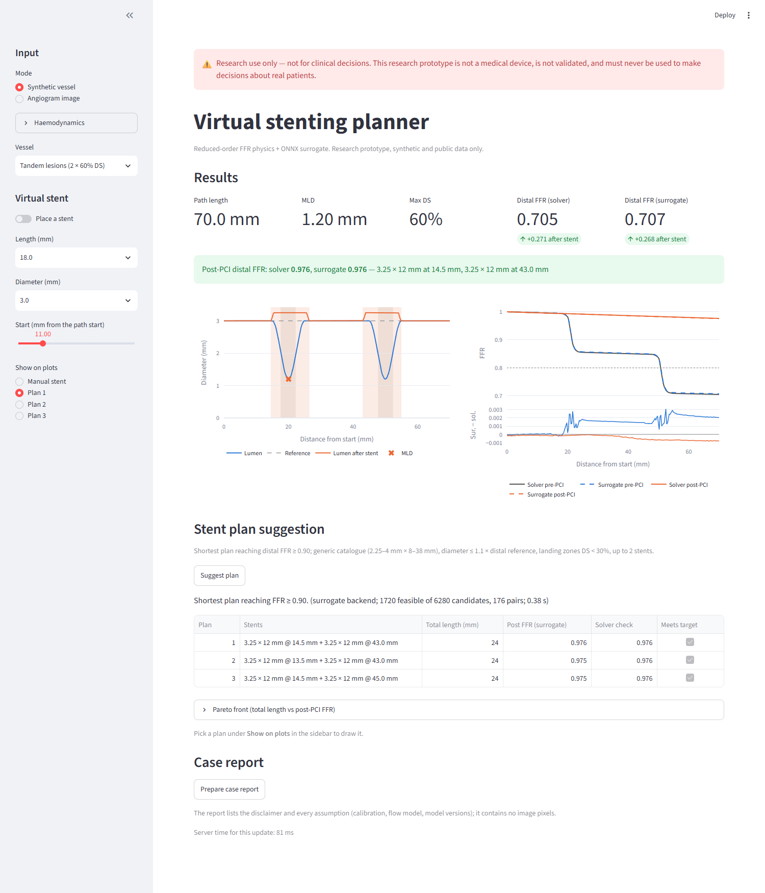
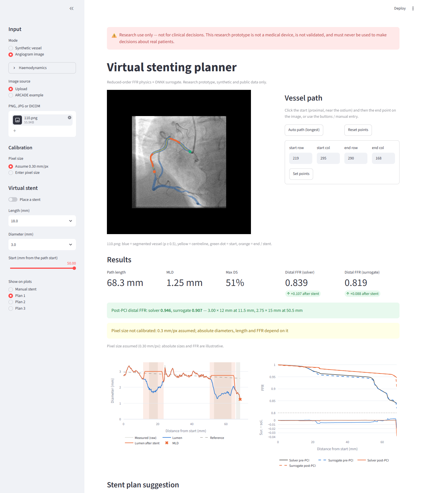

# vstent: Virtual Stenting Planner

> **⚠ Research use only — not for clinical decisions.**
> This software is a research prototype. It is not a medical device, is not validated for
> clinical use, and must never be used to make decisions about real patients.

vstent is a research prototype that:

1. segments coronary vessels in an angiogram image,
2. measures the lumen diameter profile along a user-selected vessel path (2D QCA),
3. computes an FFR pullback curve with a reduced-order physics model and a learned
   surrogate model (ONNX Runtime),
4. lets you place a virtual stent and see the predicted post-PCI FFR,
5. suggests the shortest stent that brings distal FFR back above target.





## Status

The MVP (milestones M0–M8 in [docs/PLAN.md](docs/PLAN.md)) is complete. All results are in
[reports/mvp_report.md](reports/mvp_report.md), assembled by a script from the individual
reports. Progress and open issues: [docs/PROGRESS.md](docs/PROGRESS.md). Design decisions:
[docs/DECISIONS.md](docs/DECISIONS.md).

Phase 2 is in progress on the `phase2` branch (plan: P1–P8 in [docs/PLAN.md](docs/PLAN.md)).
P1 adds 90% intervals and grey-zone flags to every distal FFR in the app, `vstent analyse` and
the case report ([reports/uncertainty.md](reports/uncertainty.md)):
- the *model interval* covers only the surrogate's error against the physics model;
- the *input interval* covers only the listed assumptions (pixel size, QCA error, hyperemic
  velocity, Pa / Pv).

**What the numbers mean:**
- The surrogate's accuracy is its agreement with the reduced-order physics model on synthetic
  vessels, not agreement with invasive FFR.
- It is not faster than that physics model. It exists to build the training → ONNX → app
  pipeline for later 3D-CFD labels.

## Setup

Requires [uv](https://docs.astral.sh/uv/) (on Windows: `winget install astral-sh.uv`) and git.

```bash
git clone <this repository> vstent && cd vstent
uv sync --all-extras            # creates .venv; Python version pinned in .python-version
uv run ruff check . && uv run ruff format --check . && uv run pytest -m "not slow" -q
```

Without uv: `python -m venv .venv`, activate it, then `pip install -e ".[dev,imaging,app]"`.

**GPU:** on Windows and Linux, PyTorch comes from the CUDA 12.6 wheel index (NVIDIA driver
≥ 560). Everything also runs on a CPU; training is then much slower.

### What works straight after setup

Trained models and datasets are never committed (`data/`, `models/`, `runs/` are git-ignored).
Right after cloning:

```bash
uv run vstent physics-report    # physics sanity checks
uv run vstent qca-synthetic     # QCA accuracy on rendered tubes
uv run vstent demo              # synthetic case end-to-end; plans with the physics solver
uv run vstent app               # app in synthetic mode (solver only)
```

### Reproducing the full pipeline

Times measured on an RTX 3060 Laptop GPU and a Ryzen 7 6800H.

```bash
uv run vstent synth --config configs/synth_v1.yaml           # ~10 s, ~0.5 GB
uv run vstent train-surrogate --config configs/surrogate.yaml # ~13 min on the GPU
uv run vstent eval-surrogate --run runs/<surrogate-run>
uv run vstent export-surrogate --run runs/<surrogate-run>     # → models/surrogate/
uv run vstent train-ensemble --config configs/ensemble.yaml   # ~80 min on the GPU (5 models)
uv run vstent export-ensemble --run runs/<ensemble-run>       # → models/surrogate/
uv run vstent data arcade                                     # ~450 MB download (CC0)
uv run vstent train-seg --config configs/seg.yaml             # ~27 min on the GPU
uv run vstent eval-seg --run runs/<seg-run>
uv run vstent export-seg --run runs/<seg-run>                 # → models/seg/
uv run vstent qca-gallery && uv run vstent plan-benchmark && uv run vstent app-latency
uv run vstent demo && uv run vstent uncertainty-report && uv run vstent mvp-report
```

Trainings can be paused and resumed exactly:
- `uv run vstent stop <run-name>` pauses after the current epoch;
- `uv run vstent checkpoints` lists runs;
- `--resume <run-name>` continues one.

## Commands

| Command | What it does | Milestone |
|---|---|---|
| `vstent physics-report` | physics sanity checks → `reports/physics_checks.md` + FFR-vs-%DS figure | M1 |
| `vstent synth --config configs/synth_v1.yaml` | generate the synthetic dataset (~0.5 GB in `data/synth/v1/`) + `reports/dataset_card.md` | M2 |
| `vstent train-surrogate --config configs/surrogate.yaml` | train the FFR surrogate (`--resume <run-name>` to continue) | M3 |
| `vstent stop <run-name>` / `vstent checkpoints` | pause a training after the current epoch / list resumable runs | — |
| `vstent eval-surrogate --run runs/<name>` | evaluate the surrogate vs the solver and a baseline → `reports/surrogate_eval.md` | M3 |
| `vstent export-surrogate --run runs/<name>` | export to ONNX (`models/surrogate/<name>/`), parity, CPU benchmark → `reports/onnx_benchmark.md` | M4 |
| `vstent train-ensemble --config configs/ensemble.yaml` | train 5 surrogates with seeds 0–4 (`--resume <name>`; `vstent stop <name>` pauses) | P1 |
| `vstent export-ensemble --run runs/<ensemble>` | export the ensemble (mean + spread) to ONNX, parity, conformal calibration on `cal` | P1 |
| `vstent uncertainty-report` | ensemble accuracy, conformal coverage, input-uncertainty intervals → `reports/uncertainty.md` | P1 |
| `vstent synth-tree --config configs/synth_tree_v1.yaml` | generate synthetic vessel trees (main vessel + 1–4 side branches) + `reports/tree_dataset_card.md` | P2 |
| `vstent tree-report` | tree physics sanity checks and solver throughput → `reports/tree_physics.md` | P2 |
| `vstent analyse <image> --tree [--stent START LEN DIA --outlet K]` | the path and its side branches with tree physics; optional virtual stent on a path | P2 |
| `vstent qca-gallery --tree` | the ARCADE gallery with tree physics vs single paths → `reports/qca_tree_gallery.md` | P2 |
| `vstent data arcade` | download, MD5-verify and extract the ARCADE dataset (CC0) into `data/raw/arcade/` | M5 |
| `vstent train-seg --config configs/seg.yaml` | train vessel segmentation (`--resume <run-name>` to continue) | M5 |
| `vstent eval-seg --run runs/<name>` | Dice on ARCADE val / test → `reports/seg_eval.md` | M5 |
| `vstent export-seg --run runs/<name>` | export segmentation to ONNX, parity → `reports/seg_onnx.md` | M5 |
| `vstent qca-synthetic` | QCA accuracy on rendered synthetic tubes → `reports/qca_synthetic.md` | M5 |
| `vstent analyse <image> [--start R C --end R C] [--plan]` | segment an angiogram; QCA + FFR (solver and surrogate) for one vessel; optionally stent plans | M5–M6 |
| `vstent qca-gallery` | qualitative QCA gallery on 20 ARCADE stenosis images → `reports/qca_gallery.md` | M5 |
| `vstent plan-benchmark` | planner speed (5,000 candidates) and behaviour on synthetic vessels → `reports/planner_benchmark.md` | M6 |
| `vstent app` | launch the Streamlit app on http://localhost:8501 (`--port`, `--address`) | M7 |
| `vstent app-latency` | time the app's response to stent-control changes → `reports/app_latency.md` | M7 |
| `vstent demo` | synthetic case end-to-end (FFR → plan → post-PCI) → `reports/demo/` | M8 |
| `vstent mvp-report` | assemble `reports/mvp_report.md` from all generated reports | M8 |

## Using the app

`uv run vstent app` opens the planner in your browser. It listens on this computer only. The
red banner is permanent: **research use only**.

1. **Pick the input** in the sidebar:
   - **Synthetic vessel:** a preset (focal, tandem) or a random synthetic vessel.
   - **Angiogram image:** upload a PNG / JPG / DICOM, or pick an ARCADE example; the vessel is
     segmented automatically.
     - Click the start (proximal) and end points on the image, or use *Auto path* or the
       manual row/col form.
     - Set the pixel size; otherwise 0.30 mm/px is assumed and flagged.
2. **Read the results:** the diameter profile (reference, lesions, MLD) and the FFR pullback
   from the solver and the surrogate, with their difference.
3. **Virtual stent** (sidebar): switch on *Place a stent*, choose a catalogue length and
   diameter, and move the start slider. Post-PCI FFR updates immediately. The app warns when a
   stent is oversized for the vessel.
4. **Suggest plan:** shows the shortest plans reaching FFR ≥ 0.90 (top 3, with the solver
   check). Pick one under *Show on plots* to draw it.
5. **Prepare case report:** download the JSON (all assumptions and model versions, no image
   pixels) and a PNG of the plots.

## Limitations

- **Physics:** steady, Newtonian, single-vessel reduced-order model without side branches.
  FFR depends strongly on the assumed microvascular resistance and hyperemic velocity
  ([docs/PHYSICS.md](docs/PHYSICS.md)).
- **Surrogate:** trained and evaluated on synthetic vessels labelled by the same model.
- **Segmentation:** trained on one public dataset (ARCADE), whose masks cover only the annotated
  SYNTAX segments.
- **QCA:**
  - a single 2D projection, so overlap and foreshortening;
  - pixel size assumed unless given;
  - crossing vessels can look like narrowings;
  - automatic paths run through branches.
- **Stent model:** it only widens the lumen. Two-stent search is heuristic, and overlapping
  stents are not modelled.
- **No clinical data:** no patient outcomes or invasive FFR were used anywhere.

Datasets and licences: [docs/DATA.md](docs/DATA.md). Notes on potentially novel elements (not
legal advice): [docs/INVENTION_NOTES.md](docs/INVENTION_NOTES.md).

## Repository layout

```
configs/      YAML configs (physics, synthetic data, training, planner, stent catalogue)
docs/         plan, progress log, decisions, physics, data, invention notes, images
src/vstent/   physics, data, surrogate, imaging, planning, inference, app, reporting, CLI
tests/        pytest suite (slow tests marked @pytest.mark.slow)
reports/      generated metrics, figures, demo and the MVP report
notebooks/    exploration only, never the source of truth
data/ models/ runs/   generated artefacts (git-ignored)
checkpoints/          resumable training state, one folder per run (git-ignored)
```
