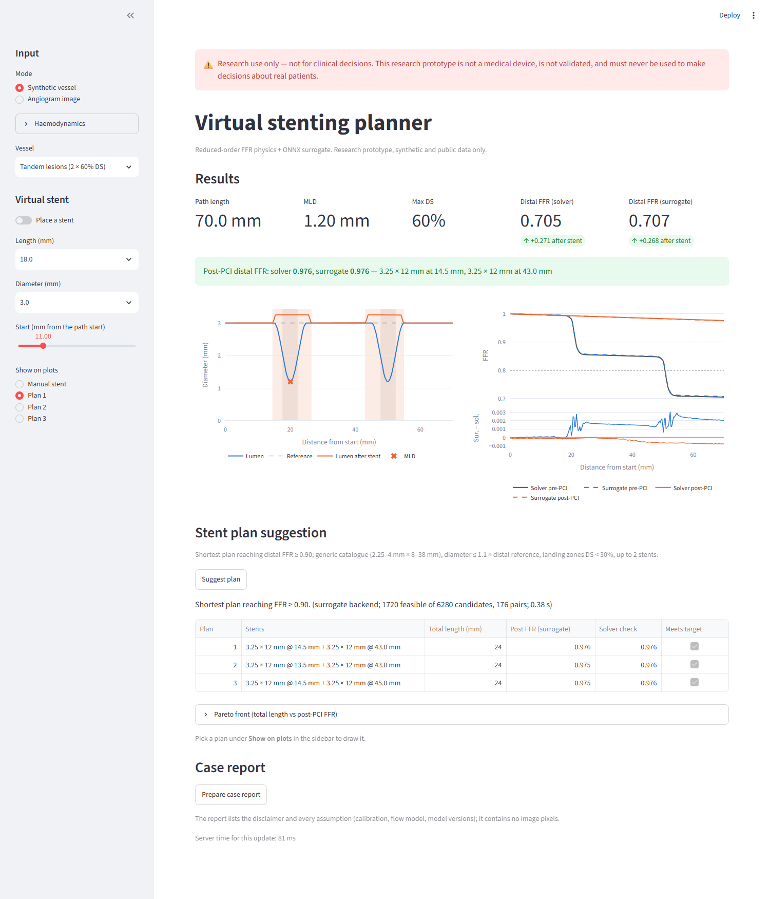
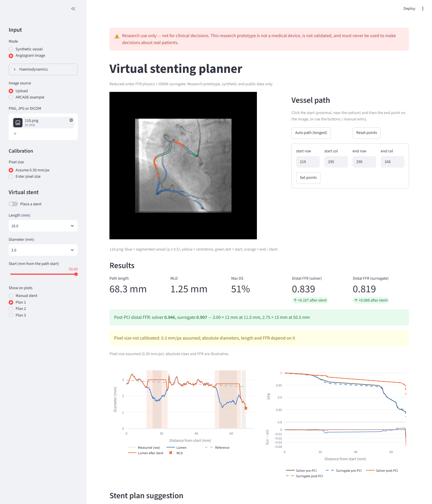

# vstent: Virtual Stenting Planner

> **⚠ Research use only — not for clinical decisions.**
> This software is a research prototype. It is not a medical device, is not validated for
> clinical use, and must never be used to make decisions about real patients.

vstent is a research prototype that:

1. segments coronary vessels in an angiogram image,
2. measures the lumen diameter profile along a user-selected vessel path (2D QCA),
3. computes an FFR pullback curve with a reduced-order physics model and a learned
   surrogate model (ONNX Runtime),
4. lets you place a virtual stent and see the predicted post-PCI FFR,
5. suggests the shortest stent that brings distal FFR back above target.





## Status

The MVP (milestones M0–M8 in [docs/PLAN.md](docs/PLAN.md)) is complete. All results are in
[reports/mvp_report.md](reports/mvp_report.md), assembled by a script from the individual
reports. Progress and open issues: [docs/PROGRESS.md](docs/PROGRESS.md). Design decisions:
[docs/DECISIONS.md](docs/DECISIONS.md).

Phase 2 is in progress on the `phase2` branch (plan: P1–P8 in [docs/PLAN.md](docs/PLAN.md)).
P1 adds 90% intervals and grey-zone flags to every distal FFR in the app, `vstent analyse` and
the case report ([reports/uncertainty.md](reports/uncertainty.md)):
- the *model interval* covers only the surrogate's error against the physics model;
- the *input interval* covers only the listed assumptions (pixel size, QCA error, hyperemic
  velocity, Pa / Pv).

P4 prepares the comparison with invasive FFR, which needs a hospital partner and ethics
approval: a protocol template and a data specification ([docs/validation/](docs/validation/)),
and `vstent validate`, tested only on synthetic stand-in cases
([reports/validation_synthetic.md](reports/validation_synthetic.md)). Patient data never enters
this repository; the tool refuses tracked locations.

P4b validates the parts on public data with independent ground truth, because no public
dataset pairs angiograms with invasive FFR:
- stenosis grading against expert grades on real angiograms from another hospital
  ([reports/stenosis_grading.md](reports/stenosis_grading.md));
- the pressure-loss physics against the FDA's inter-laboratory nozzle experiment
  ([reports/physics_nozzle.md](reports/physics_nozzle.md)).

P5 adds the projection geometry: DICOM pixel sizes are corrected for magnification, and two
views of a vessel (`vstent analyse --view2`) give its 3D centreline, so lengths are free of
foreshortening and diameters use their true magnification. The app shows both views with
the 3D path projected back, guides the second view's clicks with epipolar lines, and includes
a synthetic two-view example (P5c). On synthetic two-view pairs the
3D centreline error is 0.23 mm and the length error 0.6% (median), against 13% for one view
([reports/two_view_synthetic.md](reports/two_view_synthetic.md)). It has not yet been tested
on real two-view data.

P5b corrects the lumen's absolute size. Intensity edges read rendered vessels about 14%
narrow, so the default lumen now keeps the edges' shape (%DS unchanged) and takes the size from
the imaging-chain fit on healthy stretches: 0.0% median error on held-out renders. On real
frames its absolute accuracy is unverified; it was checked only for consistency with the
renders. Two-view lengths are now off by more than 5% in 1 of 200 synthetic cases.

P7 reads cine runs the way a cath lab records them:
- the analysis frame is the end-diastolic frame, from the DICOM R-wave pointer or ECG, or
  otherwise from the size of the vessel tree in the images;
- the contrast's flow velocity is measured along the vessel, following the heart's motion and
  correcting for phasic coronary flow. On synthetic beating hearts it is within 5.8% of the
  truth (median, two views; [reports/cine_synthetic.md](reports/cine_synthetic.md));
- it replaces the fixed hyperemic velocity only when the user asks (`--flow measured`, or the
  app's toggle), because it has not been tested against real flow.

P4e checks the model's physiology against real invasive measurements of 455 lesions
(DEFINE-FLOW, open data, [reports/physiology_real.md](reports/physiology_real.md)).
- **Phasic flow:** the diastolic flow surge that P7 corrects for is real (diastolic / systolic
  ratio 1.73), and weaker in the right coronary artery (1.35).
- **Hyperemic velocity:** the fixed velocity is plausible but at the high end, and the
  uncertainty range is narrower than real patients' spread.
- **What is missing:** these data have no angiograms; their authors are the best lead for
  angiograms with wire FFR.

P4f measures repeatability on real angiograms (CADICA). One lesion measured on different
frames of its run varies by 10 %DS points and 0.12 in FFR (SD), about twice the inter-observer
variability of accepted tools. The single-frame automatic measurement is therefore not yet
stable enough. Measuring on several frames and taking the median is the next step
([reports/repeatability.md](reports/repeatability.md)).

P8 adds regulatory groundwork drafts for review by a qualified person
([docs/regulatory/](docs/regulatory/README.md)):
- intended use and preliminary classification (India, EU, US);
- IEC 62304 safety class, development plan and architecture;
- an ISO 14971 risk management plan and hazard analysis;
- requirements traced to the tests;
- the SOUP list and an SBOM.
Requirements, hazards and the SOUP list are generated (`vstent regulatory`) and checked
against the code by the test suite.

P8 also renders synthetic angiograms from 3D vessel trees, with exact vessel labels, to train
the segmenter (`vstent synth-angio`). Adding 1,000 of them to ARCADE's 1,000 training images
made no measurable difference on real angiograms (ARCADE test Dice 0.7947 vs 0.7925, paired
difference +0.002, 95% interval −0.005 to +0.010). On rendered angiograms it raised the Dice
from 0.60 to 0.91. The model met the adoption rule set before training and is now the default
segmenter ([reports/sim_to_real.md](reports/sim_to_real.md)).

**What the numbers mean:**
- The surrogate's accuracy is its agreement with the reduced-order physics model on synthetic
  vessels, not agreement with invasive FFR.
- It is not faster than that physics model. It exists to build the training → ONNX → app
  pipeline for later 3D-CFD labels.

## Setup

Requires [uv](https://docs.astral.sh/uv/) (on Windows: `winget install astral-sh.uv`) and git.

```bash
git clone <this repository> vstent && cd vstent
uv sync --all-extras            # creates .venv; Python version pinned in .python-version
uv run ruff check . && uv run ruff format --check . && uv run pytest -m "not slow" -q
```

Without uv: `python -m venv .venv`, activate it, then `pip install -e ".[dev,imaging,app]"`.

**GPU:** on Windows and Linux, PyTorch comes from the CUDA 12.6 wheel index (NVIDIA driver
≥ 560). Everything also runs on a CPU; training is then much slower.

### What works straight after setup

Trained models and datasets are never committed (`data/`, `models/`, `runs/` are git-ignored).
Right after cloning:

```bash
uv run vstent physics-report    # physics sanity checks
uv run vstent qca-synthetic     # QCA accuracy on rendered tubes
uv run vstent demo              # synthetic case end-to-end; plans with the physics solver
uv run vstent app               # app in synthetic mode (solver only)
```

### Reproducing the full pipeline

Times measured on an RTX 3060 Laptop GPU and a Ryzen 7 6800H.

```bash
uv run vstent synth --config configs/synth_v1.yaml           # ~10 s, ~0.5 GB
uv run vstent train-surrogate --config configs/surrogate.yaml # ~13 min on the GPU
uv run vstent eval-surrogate --run runs/<surrogate-run>
uv run vstent export-surrogate --run runs/<surrogate-run>     # → models/surrogate/
uv run vstent train-ensemble --config configs/ensemble.yaml   # ~80 min on the GPU (5 models)
uv run vstent export-ensemble --run runs/<ensemble-run>       # → models/surrogate/
uv run vstent data arcade                                     # ~450 MB download (CC0)
uv run vstent train-seg --config configs/seg.yaml             # ~27 min on the GPU
uv run vstent eval-seg --run runs/<seg-run>
uv run vstent export-seg --run runs/<seg-run>                 # → models/seg/
uv run vstent qca-gallery && uv run vstent plan-benchmark && uv run vstent app-latency
uv run vstent demo && uv run vstent uncertainty-report && uv run vstent mvp-report
```

Trainings can be paused and resumed exactly:
- `uv run vstent stop <run-name>` pauses after the current epoch;
- `uv run vstent checkpoints` lists runs;
- `--resume <run-name>` continues one.

## Commands

| Command | What it does | Milestone |
|---|---|---|
| `vstent physics-report` | physics sanity checks → `reports/physics_checks.md` + FFR-vs-%DS figure | M1 |
| `vstent synth --config configs/synth_v1.yaml` | generate the synthetic dataset (~0.5 GB in `data/synth/v1/`) + `reports/dataset_card.md` | M2 |
| `vstent train-surrogate --config configs/surrogate.yaml` | train the FFR surrogate (`--resume <run-name>` to continue) | M3 |
| `vstent stop <run-name>` / `vstent checkpoints` | pause a training after the current epoch / list resumable runs | — |
| `vstent eval-surrogate --run runs/<name>` | evaluate the surrogate vs the solver and a baseline → `reports/surrogate_eval.md` | M3 |
| `vstent export-surrogate --run runs/<name>` | export to ONNX (`models/surrogate/<name>/`), parity, CPU benchmark → `reports/onnx_benchmark.md` | M4 |
| `vstent train-ensemble --config configs/ensemble.yaml` | train 5 surrogates with seeds 0–4 (`--resume <name>`; `vstent stop <name>` pauses) | P1 |
| `vstent export-ensemble --run runs/<ensemble>` | export the ensemble (mean + spread) to ONNX, parity, conformal calibration on `cal` | P1 |
| `vstent uncertainty-report` | ensemble accuracy, conformal coverage, input-uncertainty intervals → `reports/uncertainty.md` | P1 |
| `vstent synth-tree --config configs/synth_tree_v1.yaml` | generate synthetic vessel trees (main vessel + 1–4 side branches) + `reports/tree_dataset_card.md` | P2 |
| `vstent tree-report` | tree physics sanity checks and solver throughput → `reports/tree_physics.md` | P2 |
| `vstent analyse <image> --tree [--plan \| --stent START LEN DIA] [--outlet K]` | the path and its side branches with tree physics; stent plans or a virtual stent on the path to branch K | P2–P3 |
| `vstent train-tree-surrogate --config configs/tree_surrogate.yaml` | train the tree surrogate (graph network; `--resume <name>`) | P3 |
| `vstent eval-tree-surrogate --run runs/<name>` / `vstent export-tree-surrogate --run runs/<name>` | tree surrogate vs tree solver → `reports/tree_surrogate_eval.md`; ONNX + parity → `reports/tree_onnx.md` | P3 |
| `vstent plan-benchmark --tree` | tree planner speed and behaviour → `reports/tree_planner_benchmark.md` | P3 |
| `vstent qca-gallery --tree` | the ARCADE gallery with tree physics vs single paths → `reports/qca_tree_gallery.md` | P2 |
| `vstent validate --manifest cases.csv [--reference reference.csv]` | validation against wire FFR on a local, de-identified case list: locked predictions, then AUC, Bland–Altman, sensitivity / specificity, grey zone, per-territory tables ([docs/validation/](docs/validation/)) | P4 |
| `vstent validate-synthetic` | the validation tool end to end on synthetic stand-in cases → `reports/validation_synthetic.md` | P4 |
| `vstent sample-size` | sample size for the validation study (placeholder assumptions) → `reports/validation_sample_size.md` | P4 |
| `vstent data cadica` / `vstent data fda-nozzle` | download and verify the public validation datasets (CADICA, CC BY 4.0; FDA nozzle, public domain) | P4b |
| `vstent stenosis-grading [--edges probability,intensity,model] [--workers N]` | automatic %DS at every CADICA expert lesion vs the experts' grades, per lumen method → `reports/stenosis_grading.md` | P4b–P4c |
| `vstent cine-synthetic [--workers N] [--calibrate]` | end-diastolic frames and flow velocity on synthetic beating-heart runs against the truth → `reports/cine_synthetic.md`; `--calibrate`: the velocity intervals on development seeds → `reports/cine_calibration.md` | P7 |
| `vstent analyse <run.dcm> [--flow measured] [--hyperemic-run]` | a cine run on its end-diastolic frame (R-wave pointer, ECG or images) with the contrast flow velocity; `--flow measured` uses it instead of the fixed hyperemic velocity | P7 |
| `vstent data define-flow` / `vstent data contrast` | download and verify open invasive physiology data (DEFINE-FLOW, CONTRAST; CC0) | P4e |
| `vstent physiology-real` | the model's physiology assumptions against DEFINE-FLOW's invasive measurements → `reports/physiology_real.md` | P4e |
| `vstent repeatability [--workers N]` | frame-to-frame and operator-to-operator repeatability of %DS and FFR on CADICA's real angiograms → `reports/repeatability.md` | P4f |
| `vstent cine-frames` | every CADICA cine run: automatic analysis frame and opacified window vs the frames the clinicians selected, and contrast transit → `reports/cine_frames.md` | P4d |
| `vstent lumen-synthetic` | lumen methods (intensity edges, imaging-chain model) on rendered vessels with known tight and eccentric lumens → `reports/lumen_synthetic.md` | P4c |
| `vstent physics-nozzle` | the loss model vs the FDA benchmark nozzle experiments → `reports/physics_nozzle.md` | P4b |
| `vstent analyse <view1> --view2 <view2> --start R C --end R C --start2 R C --end2 R C [--plan]` | two views (DICOM with geometry): 3D centreline, foreshortening-free length, FFR, figure with the 3D path projected back | P5 |
| `vstent two-view-synthetic [--workers N]` | two-view reconstruction on synthetic C-arm pairs vs single view → `reports/two_view_synthetic.md` | P5 |
| `vstent synth-angio [--config configs/synth_angio_v1.yaml]` | render synthetic angiograms with vessel labels for segmentation training → `data/synth_angio/v1/` + `reports/synth_angio_card.md` | P8 |
| `vstent train-seg --config configs/seg_synth.yaml` | train the segmenter with rendered angiograms added to ARCADE (`--resume <run-name>`) | P8 |
| `vstent sim-to-real-report --base runs/<M5> --new runs/<new>` | both segmenters on ARCADE val / test and rendered test, paired differences, the adoption rule → `reports/sim_to_real.md` | P8 |
| `vstent regulatory [--check]` | regulatory drafts: requirements, hazards, traceability, SOUP list and SBOM → `docs/regulatory/`; fails on any broken reference (`--check`: write nothing, fail if out of date) | P8 |
| `vstent data arcade` | download, MD5-verify and extract the ARCADE dataset (CC0) into `data/raw/arcade/` | M5 |
| `vstent train-seg --config configs/seg.yaml` | train vessel segmentation (`--resume <run-name>` to continue) | M5 |
| `vstent eval-seg --run runs/<name>` | Dice on ARCADE val / test → `reports/seg_eval.md` | M5 |
| `vstent export-seg --run runs/<name>` | export segmentation to ONNX, parity → `reports/seg_onnx.md` | M5 |
| `vstent qca-synthetic` | QCA accuracy on rendered synthetic tubes → `reports/qca_synthetic.md` | M5 |
| `vstent analyse <image> [--start R C --end R C] [--plan] [--lumen edges\|model]` | segment an angiogram; QCA + FFR (solver and surrogate) for one vessel; optionally stent plans; `--lumen` picks the lumen measurement | M5–M6, P4c |
| `vstent qca-gallery` | qualitative QCA gallery on 20 ARCADE stenosis images → `reports/qca_gallery.md` | M5 |
| `vstent plan-benchmark` | planner speed (5,000 candidates) and behaviour on synthetic vessels → `reports/planner_benchmark.md` | M6 |
| `vstent app` | launch the Streamlit app on http://localhost:8501 (`--port`, `--address`) | M7 |
| `vstent app-latency` | time the app's response to stent-control changes → `reports/app_latency.md` | M7 |
| `vstent demo` | synthetic case end-to-end (FFR → plan → post-PCI) → `reports/demo/` | M8 |
| `vstent mvp-report` | assemble `reports/mvp_report.md` from all generated reports | M8 |

## Using the app

`uv run vstent app` opens the planner in your browser. It listens on this computer only. The
red banner is permanent: **research use only**.

1. **Pick the input** in the sidebar:
   - **Synthetic vessel:** a preset (focal, tandem) or a random synthetic vessel.
   - **Angiogram image:** upload a PNG / JPG / DICOM, or pick an ARCADE example; the vessel is
     segmented automatically.
     - Click the start (proximal) and end points on the image, or use *Auto path* or the
       manual row/col form.
     - Set the pixel size: DICOM with geometry is corrected to the isocentre automatically;
       otherwise 0.30 mm/px is assumed and flagged.
   - **Two views (3D):** with a DICOM that has projection geometry, switch on *Second view
     (3D)* and upload the second run; or pick *Two-view example (synthetic)*. Click the same
     two landmarks in view 2; the grey lines show where they must lie. Lengths and FFR then
     follow the 3D centreline, drawn back into both views.
2. **Read the results:** the diameter profile (reference, lesions, MLD) and the FFR pullback
   from the solver and the surrogate, with their difference.
3. **Virtual stent** (sidebar): switch on *Place a stent*, choose a catalogue length and
   diameter, and move the start slider. Post-PCI FFR updates immediately. The app warns when a
   stent is oversized for the vessel.
4. **Suggest plan:** shows the shortest plans reaching FFR ≥ 0.90 (top 3, with the solver
   check). Pick one under *Show on plots* to draw it.
5. **Side branches (image mode):** switch on *Side branches (tree model)*. The side branches leaving the path are measured and FFR is shown along every path. Pick a path (*Path to*), place a stent on it or ask for plans; the stent may run from the main vessel into a side branch. A JSON tree report can be downloaded.
6. **Prepare case report:** download the JSON (all assumptions and model versions, no image
   pixels) and a PNG of the plots.

## Limitations

- **Physics:** steady, Newtonian reduced-order model. Side branches are modelled one level
  deep with a Murray flow split; junction losses are neglected (P2). FFR depends strongly on
  the assumed microvascular resistance and hyperemic velocity, and the flow is set by the
  measured inlet reference diameter ([docs/PHYSICS.md](docs/PHYSICS.md)).
- **Surrogate:** trained and evaluated on synthetic vessels labelled by the same model.
- **Segmentation:** trained on one public dataset (ARCADE), whose masks cover only the annotated
  SYNTAX segments.
- **QCA:**
  - one 2D projection by default, so overlap and foreshortening; two views (`--view2` or
    the app, P5) reconstruct the vessel in 3D, tested on synthetic pairs only;
  - pixel size assumed unless given or read from the DICOM geometry (corrected to the
    isocentre: exact only at the isocentre's depth in one view);
  - the absolute lumen size comes from an imaging-chain fit (P5b), verified on rendered
    vessels only; intensity edges alone read them about 14% narrow;
  - crossing vessels can look like narrowings;
  - automatic paths run through branches.
- **Stent model:** it only widens the lumen. Two-stent search is heuristic, and overlapping
  stents are not modelled.
- **No clinical data:** no patient outcomes or invasive FFR were used anywhere. The validation
  tool (P4) has run only on synthetic stand-in cases.

Datasets and licences: [docs/DATA.md](docs/DATA.md). Notes on potentially novel elements (not
legal advice): [docs/INVENTION_NOTES.md](docs/INVENTION_NOTES.md).

## Repository layout

```
configs/      YAML configs (physics, synthetic data, training, planner, stent catalogue)
docs/         plan, progress log, decisions, physics, data, invention notes, images,
              validation/ (protocol template, data specification, CSV templates)
src/vstent/   physics, data, surrogate, imaging, planning, inference, app, reporting, CLI
tests/        pytest suite (slow tests marked @pytest.mark.slow)
reports/      generated metrics, figures, demo and the MVP report
notebooks/    exploration only, never the source of truth
data/ models/ runs/   generated artefacts (git-ignored)
checkpoints/          resumable training state, one folder per run (git-ignored)
```
