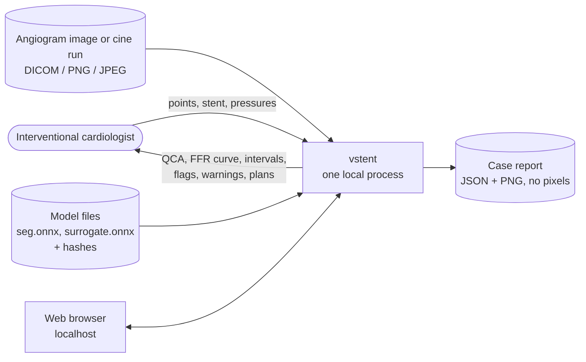
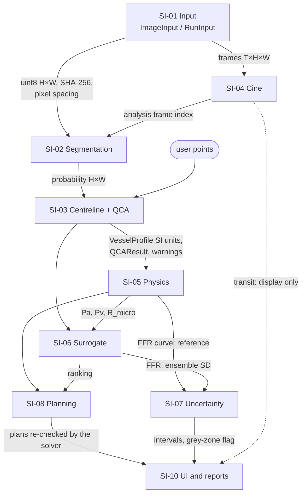

# Software architecture (draft)

> **Research use only — not for clinical decisions.** Draft regulatory groundwork for review by
> a qualified person; not regulatory advice. Version 0.1, 2026-11-01, not reviewed.

IEC 62304 §5.3. The software system, its items, their interfaces and the SOUP each one uses.
Safety class C for every item, because nothing is segregated at run time
([SAFETY_CLASS.md](SAFETY_CLASS.md)).

## 1. Context

The software runs on one computer (Windows or Linux, CPU), serves the app on localhost
(SR-34) and makes no network calls during an analysis. There is no patient database, no
PACS link and no user account.

## 2. Software items of the analysis path

This is the set of modules the app loads, measured by importing the app's modules (torch is
never loaded; the models run in ONNX Runtime).

| ID | Item | Modules (`src/vstent/`) | Responsibility | SOUP |
|---|---|---|---|---|
| SI-01 | Input | `imaging/image_io.py` | Read images and cine runs (one intensity scale per run), pixel spacing, frame time, SHA-256 | pydicom, numpy, opencv |
| SI-02 | Segmentation | `imaging/segment.py` (pre-processing), `inference/onnx_runtime.py` (`SegmentationRunner`), `inference/models.py` | Vessel probability map from an image | onnxruntime, numpy, opencv |
| SI-03 | Centreline and QCA | `imaging/centerline.py`, `imaging/qca.py`, `imaging/qca_tree.py`, `imaging/lumen_model.py` | Skeleton graph, path between the user's points, gap bridging, diameters from intensity edges (or the lumen model), reference, %DS, warnings | scikit-image, networkx, scipy, numpy |
| SI-04 | Cine | `imaging/cine.py` | Opacification curve, analysis frame, contrast transit (display only) | numpy, scipy |
| SI-05 | Physics | `physics/geometry.py`, `physics/solver.py`, `physics/tree.py` | Vessel profile, reduced-order FFR, R_micro calibration, tree solver | numpy |
| SI-06 | Surrogate | `surrogate/features.py`, `surrogate/tree_features.py`, `inference/onnx_runtime.py` (`SurrogateRunner`), `inference/tree_runtime.py` | Shared pre-processing; ONNX surrogate FFR with ensemble spread | onnxruntime, numpy |
| SI-07 | Uncertainty | `uncertainty/conformal.py`, `uncertainty/inputs.py`, `uncertainty/greyzone.py` | Model and input intervals, grey-zone flags | numpy, scipy |
| SI-08 | Planning | `planning/stent.py`, `planning/optimizer.py`, `planning/tree_planner.py` | Virtual stent, candidates, sizing rule, ranking, solver re-check | numpy |
| SI-09 | Orchestration | `inference/pipeline.py` | Image → QCA → solver + surrogate → warnings | – |
| SI-10 | User interface and reports | `app/streamlit_app.py`, `app/core.py`, `app/tree_view.py`, `cli.py` (`analyse`, `app`), `inference/figures.py`, `plotting.py` | Interaction, display, case report, research-use notice | streamlit, streamlit-image-coordinates, plotly, matplotlib, pandas, pyarrow, typer |
| SI-11 | Shared | `config.py`, `units.py`, `sysinfo.py`, `data/synth.py`, `data/synth_tree.py` | Strict configs, unit conversion, CPU name; the synthetic sampling ranges (used for the out-of-range warnings and the app's synthetic presets) | pydantic, pyyaml |

Optional, not on the default path: `imaging/calibration.py` (frame-level imaging-chain
calibration, D46).

## 3. Tools (not part of the device software)

| Tools | Modules | Produce |
|---|---|---|
| Training and export | `surrogate/` (all but the two feature modules), `imaging/seg_train.py`, `seg_eval.py`, `seg_export.py`, `checkpoints.py` | The released model files and their evaluation reports |
| Data | `data/` (all but `synth.py`, `synth_tree.py` at run time), `imaging/synthetic.py` | Synthetic datasets, public-dataset downloads |
| Evidence | `validation/`, `physics/report.py`, `physics/tree_report.py`, `physics/nozzle.py`, `imaging/qca_validation.py`, `imaging/lumen_report.py`, `inference/benchmark.py`, `inference/gallery.py`, `planning/report.py`, `uncertainty/report.py`, `app/latency.py`, `reporting/` | Reports in `reports/` |
| Documentation | `regulatory/` | This folder's generated documents |

They run the same code as the analysis path where they measure it (one source of truth for
pre-processing), which is why the evidence applies to the released items.

## 4. Data flow and interfaces

| Interface | Type | Units and checks |
|---|---|---|
| Image | `ImageInput` (uint8 H×W, `sha256`, `pixel_spacing_mm`) | 8-bit greyscale; one conversion everywhere (SR-04) |
| Run | `RunInput` (uint8 T×H×W, `frame_time_ms`) | One intensity scale per run (SR-05) |
| Vessel map | float H×W in [0, 1] | Threshold 0.5 (`imaging/segment.py::THRESHOLD`) |
| Vessel profile | `VesselProfile` (s, r in m; read-only arrays) | Positive radii, increasing s, refused otherwise (SR-17) |
| FFR | `FFRResult` (FFR per point, Q in m³/s, Pa / Pv in Pa, R_micro in Pa·s/m³) | Starts at 1, never increases (SR-14) |
| Surrogate | `SurrogateRunner.predict_profile_with_spread` | Normalisation statistics matched to the model (SR-18) |
| Assessment | `Assessment` (intervals, flags, reasons) | Threshold 0.80 or the planner target (SR-24) |
| Plans | `PlanResult` (plans, Pareto front, solver checks) | Catalogue sizes, sizing rule (SR-26) |
| Case report | JSON (no pixels) + PNG | Input and model SHA-256, version, commit, warnings (SR-36) |

## 5. Design features that control risk

- **The solver is the reference.** The reduced-order solver runs for every analysis; the
  surrogate is shown beside it and its plans are re-checked by it (SR-21).
- **One pre-processing function** for training, ONNX inference and the app, with tested parity
  (SR-07, SR-18).
- **A torch-free analysis path:** the run-time SOUP is smaller, and the model is a fixed ONNX
  file with a recorded hash.
- **Strict configuration:** unknown keys are refused (SR-38).
- **Warnings travel with the result** to every output (SR-02).

## 6. Changes recommended before a release

1. **Package the analysis path alone** (sections 2 and 3): no torch, training or evidence
   tools in the device software. This shrinks the shipped SOUP (today 108 packages,
   [SOUP.md](SOUP.md)).
2. **Move the training ranges into the model's metadata** (today they come from
   `data/synth.py`), so the out-of-range warning always belongs to the model in use.
3. **Release models as versioned, signed artefacts** with their evaluation reports (today
   `models/` is outside git, H-18).
4. **Consider segregation** of the FFR computation behind a narrow interface (separate
   process or an independent consistency check), if a lower class is to be argued for the UI
   items.
