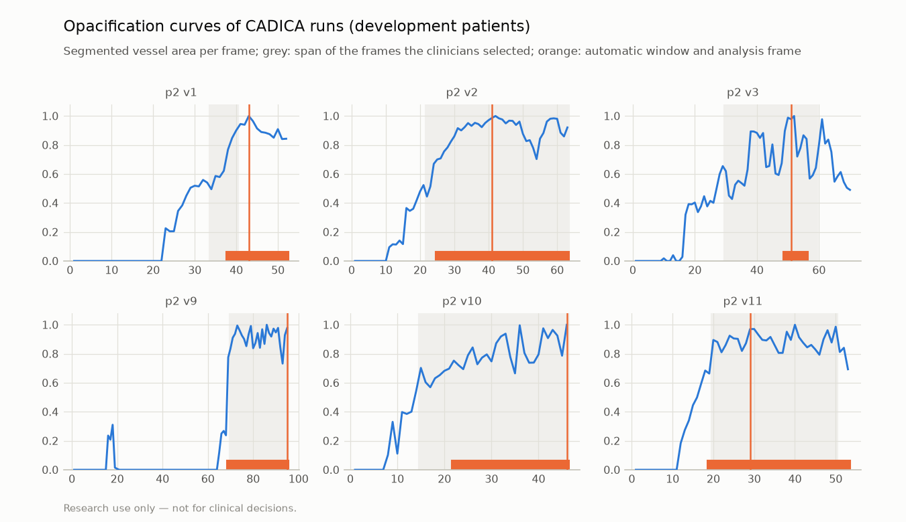

# Cine runs: automatic analysis frame vs the CADICA clinicians' selected frames

> Research use only — not for clinical decisions.

Generated by `vstent cine-frames`. Do not edit by hand.

**Data:** the CADICA dataset (CC BY 4.0, `docs/DATA.md`): full cine runs of 42 patients and, for each of its 382 selected runs, the frames the clinicians selected (the keyframes; in lesion runs the lesion boxes are drawn on them). These frames are the reference here; no lesion grade, flow or FFR is involved.

**Method (no user input):** every frame is segmented; the vessel area per frame, median-filtered over 3 frames, is the opacification curve. The analysis frame is its peak (the most completely filled vessels); the opacified window is the run of frames around the peak above 70% of it, a fraction chosen on the development runs (D47); contrast arrival is the first frame above 50%. Patients are split as in `reports/stenosis_grading.md`; this is the first use of the test patients for this task. Intervals: Wilson (rates; runs as units) and a patient-level bootstrap (median IoU).

## Results

| Runs | Runs (patients) | Analysis frame among the selected frames | Within their span | Window overlap (IoU), median (IQR; 95% CI) | Contrast arrival ≤ first selected frame |
|---|---:|---:|---:|---:|---:|
| test patients | 177 (21) | 131 / 177 (74%; 67–80%) | 145 / 177 (82%; 76–87%) | 0.59 (0.38–0.73; 0.52–0.67) | 167 / 177 (94%; 90–97%) |
| development patients | 205 (21) | 160 / 205 (78%; 72–83%) | 166 / 205 (81%; 75–86%) | 0.55 (0.35–0.71; 0.50–0.63) | 197 / 205 (96%; 92–98%) |

Test patients by run type:

| Runs | Runs (patients) | Analysis frame among the selected frames | Within their span | Window overlap (IoU), median (IQR; 95% CI) | Contrast arrival ≤ first selected frame |
|---|---:|---:|---:|---:|---:|
| lesion runs | 116 (21) | 82 / 116 (71%; 62–78%) | 96 / 116 (83%; 75–89%) | 0.56 (0.33–0.72; 0.47–0.60) | 112 / 116 (97%; 91–99%) |
| runs without lesion | 61 (16) | 49 / 61 (80%; 69–88%) | 49 / 61 (80%; 69–88%) | 0.68 (0.44–0.81; 0.62–0.70) | 55 / 61 (90%; 80–95%) |

## Contrast transit (feasibility; no reference)

Along the longest vessel path of each run's analysis frame: the frame in which the contrast arrives at each point (the darkest value within 6 px, for cardiac motion), and the front speed, the Theil–Sen slope of the distance from the inflow on the arrival frame. A speed counts only if it and the lower end of its 95% interval are positive (a front that advances); otherwise the product reports the transit as not measurable. CADICA gives no pixel size, so speeds are in px per frame; without a flow reference this shows only how often the measurement is possible and how precise it is.

- Plausible in 210 of 382 runs (55%); front not advancing steadily: 165; not measured: no contrast arrival measured along the path; the vessel mask has no skeleton.
- Front speed, px per frame, median (IQR): all runs 17.6 (10.9–28.2); left coronary 17.6 (10.9–27.4); right coronary 21.0 (11.2–32.6).
- Width of the speed's 95% interval relative to the speed, %, median (IQR): 40.3 (27.1–73.3).

Segmentation model `models/seg/seg_unet_r34_synth-20261101-182811`. Commit `acd6a5cfddcc186ebf7753e7990ca708e5adf70e` (dirty: False). Per-run values: `cine_frames.json`.
