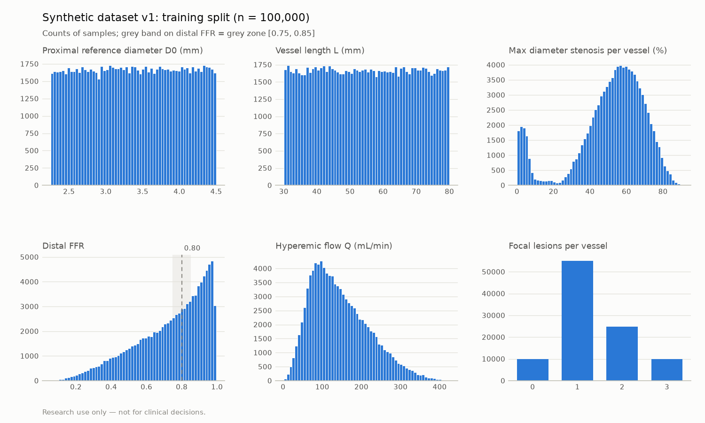

# Dataset card: synthetic vessels v1

> **Research use only — not for clinical decisions.** Synthetic data only; no patient data.

Generated by `vstent synth`. Do not edit by hand.

## What it is

Single coronary-like vessels (no side branches) as radius profiles on 256 points: a linearly tapered reference, 0-4 focal lesions (cosine, skewed_cosine, plateau, irregular), optional diffuse disease and smoothed measurement noise. Labels (FFR(s), ΔP(s), Q, R_micro) come from the reduced-order solver (docs/PHYSICS.md), computed on exactly the stored float32 noisy profile. Sampling ranges: `config.yaml` next to the data (copy of `configs/synth_v1.yaml`).

## Acceptance targets (in-distribution splits)

| Split | FFR < 0.80 | Target | Grey zone [0.75, 0.85] | Target | Pass |
|---|---|---|---|---|---|
| train | 53.3% | ≥ 30% | 18.4% | ≥ 15% | yes |
| val | 54.2% | ≥ 30% | 18.1% | ≥ 15% | yes |
| test | 53.8% | ≥ 30% | 17.8% | ≥ 15% | yes |

## Splits

Values are median [5th, 95th percentile].

| Split | n | Seed | Distal FFR | FFR < 0.80 | Grey zone | D0 (mm) | L (mm) | Max DS (%) | Q (mL/min) | Lesions 0/1/2/3/4 | Diffuse | R_micro clamped |
|---|---|---|---|---|---|---|---|---|---|---|---|---|
| train | 100,000 | 1001 | 0.782 [0.348, 0.973] | 53.3% | 18.4% | 3.38 [2.37, 4.39] | 55.0 [32.5, 77.5] | 55.0 [4.0, 76.1] | 132 [46, 286] | 9953/55128/24919/10000/0 | 20.0% | 0 |
| val | 10,000 | 1002 | 0.777 [0.345, 0.974] | 54.2% | 18.1% | 3.38 [2.35, 4.38] | 55.4 [32.7, 77.6] | 55.2 [3.9, 76.1] | 131 [45, 285] | 992/5427/2563/1018/0 | 19.9% | 0 |
| test | 10,000 | 1003 | 0.777 [0.342, 0.973] | 53.8% | 17.8% | 3.38 [2.37, 4.39] | 54.8 [32.4, 77.5] | 55.5 [3.9, 76.4] | 133 [45, 283] | 1010/5547/2474/969/0 | 20.0% | 0 |
| ood | 5,000 | 1004 | 0.516 [0.233, 0.788] | 96.1% | 7.4% | 3.38 [2.35, 4.39] | 99.9 [82.1, 118.2] | 65.6 [49.9, 80.1] | 89 [29, 209] | 0/0/0/2492/2508 | 19.6% | 0 |

Lesion shapes (train): cosine 33,611, skewed_cosine 34,007, plateau 33,818, irregular 33,530.

## Distributions (train)

## Generation

- 125,000 samples in 8.4 s with 13 worker processes on AMD Ryzen 7 6800H with Radeon Graphics
- git commit: `86ec53c506e22eadea9282bb03279a970ef42240` (dirty: False), vstent 0.1.0, generated 2026-10-28T09:00:40+00:00
- Reproducible: shard seeds are (split seed, shard index), independent of the number of workers; per-shard content SHA-256 hashes are in `manifest.json`.

## Limitations

- Geometry is synthetic and idealised (straight single vessel, circular lumen, no side branches, no bifurcation lesions).
- Labels are reduced-order model outputs, not 3D CFD or invasive FFR; the surrogate trained on them can be no more accurate than this model.
- `ood` (80-120 mm, 3-4 lesions) is out of distribution by design; it has no targets.
