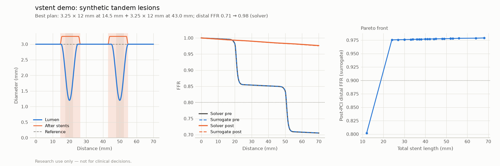

# vstent demo: synthetic tandem lesions

> **Research use only — not for clinical decisions.**

Generated by `vstent demo`. Do not edit by hand.

**Vessel:** 70 mm, 3.0 mm reference, two 10 mm lesions of 60% DS at 20 and 50 mm (synthetic; Pa 90 mmHg, Pv 5 mmHg).

**Planning backend:** surrogate.

| Step | Result | Time |
|---|---|---|
| Pre-PCI distal FFR (solver / surrogate) | 0.705 / 0.706 | 9 ms |
| Stent plan search | 1720 feasible of 6280 single-stent candidates, 176 pairs; Shortest plan reaching FFR >= 0.90. | 711 ms |
| Best plan | 3.25 × 12 mm at 14.5 mm + 3.25 × 12 mm at 43.0 mm | |
| Post-PCI distal FFR (solver / surrogate) | 0.976 / 0.976 | 9 ms |

| Plan | Stents | Total length | Post FFR (planning backend) | Solver check |
|---|---|---|---|---|
| 1 | 3.25 × 12 mm at 14.5 mm + 3.25 × 12 mm at 43.0 mm | 24 mm | 0.976 | 0.976 |
| 2 | 3.25 × 12 mm at 13.5 mm + 3.25 × 12 mm at 43.0 mm | 24 mm | 0.976 | 0.976 |
| 3 | 3.25 × 12 mm at 14.5 mm + 3.25 × 12 mm at 45.0 mm | 24 mm | 0.976 | 0.976 |

**Uncertainty (90% intervals).** Inputs varied: hyperemic velocity, Pa / Pv (500 Monte Carlo draws through the solver; 13 ms).

| Distal FFR | Input interval (solver) | Model interval (surrogate) | Threshold | Grey zone |
|---|---|---|---|---|
| Pre-PCI | 0.622–0.791 | 0.704–0.708 | 0.80 | no |
| Post-PCI, best plan | 0.967–0.984 | 0.975–0.976 | 0.90 | no |

Model intervals cover only the surrogate's error against the reduced-order solver (split-conformal, calibrated on synthetic vessels). Input intervals cover only the listed assumptions. Neither covers the error of the reduced-order model itself.

Post-PCI FFR keeps the pre-PCI microvascular resistance, Pa and Pv (only the lumen changes). Full case report with all assumptions: `demo.json`.

Surrogate model: `models/surrogate/unet1d_ens5-20261030-113237`; commit `c7bbd4685d5a75d0bab7ffb003a97d68f1a47d8d` (dirty: False), vstent 0.1.0, 2026-10-30T15:23:55+00:00.
