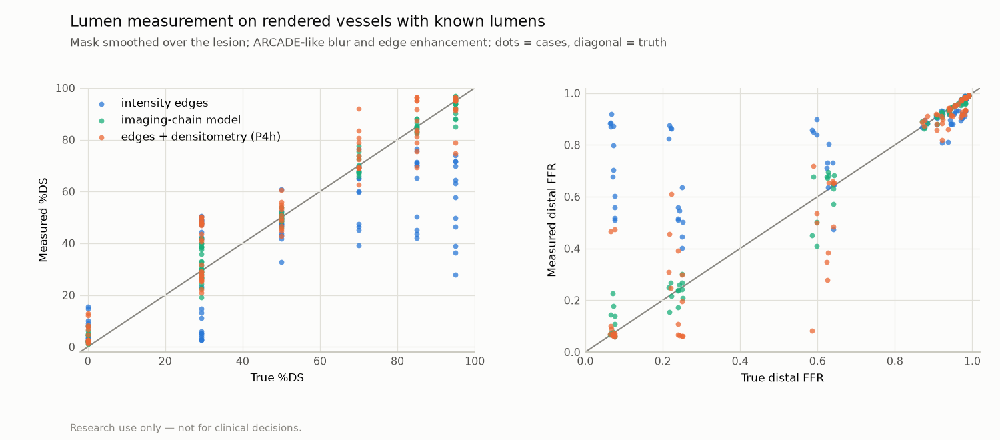

# Lumen measurement on rendered vessels: intensity edges, the imaging-chain model and densitometry

> **Research use only — not for clinical decisions.**

Generated by `vstent lumen-synthetic`. Do not edit by hand.

Vessels of 8, 12, 16 px with one 30 px cosine lesion, 4 renders each (seeds from 4100), rendered as X-ray projections with the ARCADE-fitted contrast, blur, edge enhancement and noise of the synthetic validation study. The mask given to QCA is the unnarrowed vessel (a segmentation that smoothed over the lesion), so the lesion is seen only in the image. Eccentric lumens are narrowed by half in the image plane or along the X-ray; their truth is the area-equivalent %DS. FFR: the reduced-order solver on the true lumen and on each QCA profile (default physics, calibrated pixel size).

**Caveat:** the renderer and the model share their physics, so this is the model's best case. Real angiograms: `reports/stenosis_grading.md`.

| Target | Value | Required | Status |
|---|---|---|---|
| Model, circular lesions ≥ 85%: mean |%DS error| | 2.3 points (edges 30.7) | ≤ 10 points | PASS |
| Model, eccentric lumens: mean |%DS error| | 5.5 points (edges 19.7) | ≤ 10 points | PASS |
| Densitometry (P4h), circular lesions ≥ 85%: mean |%DS error| | 5.9 points (edges 30.7) | ≤ 10 points | PASS |
| Densitometry (P4h), no lesion: mean |%DS error| | 5.5 points (edges 6.5) | ≤ 8 points | PASS |

Mean absolute error by lesion group:

| Lesions | %DS, edges | %DS, model | %DS, densitometry | FFR, edges | FFR, model | FFR, densitometry |
|---|---:|---:|---:|---:|---:|---:|
| circular, true < 85% DS | 8.5 | 2.3 | 5.4 | 0.080 | 0.040 | 0.093 |
| circular, true ≥ 85% DS | 30.7 | 2.3 | 5.9 | 0.527 | 0.035 | 0.116 |
| eccentric (area-equivalent 29% DS) | 19.7 | 5.5 | 10.4 | 0.040 | 0.009 | 0.027 |
| no lesion | 6.5 | 3.7 | 5.5 | 0.013 | 0.001 | 0.002 |

Means per case (over seeds):

| Reference (px) | Lesion | True %DS | Edges %DS | Model %DS | Dense %DS | True FFR | Edges FFR | Model FFR | Dense FFR |
|---:|---|---:|---:|---:|---:|---:|---:|---:|---:|
| 8 | circular 50% | 50 | 40 | 50 | 46 | 0.88 | 0.88 | 0.88 | 0.89 |
| 8 | circular 70% | 70 | 45 | 73 | 75 | 0.59 | 0.86 | 0.51 | 0.46 |
| 8 | circular 85% | 85 | 45 | 85 | 77 | 0.22 | 0.86 | 0.22 | 0.41 |
| 8 | circular 95% | 95 | 37 | 92 | 87 | 0.07 | 0.89 | 0.09 | 0.18 |
| 8 | in-plane 50% | 29 | 44 | 30 | 43 | 0.94 | 0.86 | 0.94 | 0.90 |
| 8 | along the ray 50% | 29 | 14 | 35 | 27 | 0.94 | 0.92 | 0.93 | 0.94 |
| 8 | none 0% | 0 | 12 | 6 | 10 | 0.96 | 0.93 | 0.95 | 0.95 |
| 12 | circular 50% | 50 | 49 | 50 | 51 | 0.91 | 0.90 | 0.90 | 0.89 |
| 12 | circular 70% | 70 | 63 | 67 | 78 | 0.63 | 0.72 | 0.68 | 0.42 |
| 12 | circular 85% | 85 | 71 | 86 | 90 | 0.24 | 0.53 | 0.23 | 0.16 |
| 12 | circular 95% | 95 | 59 | 91 | 95 | 0.07 | 0.76 | 0.14 | 0.07 |
| 12 | in-plane 50% | 29 | 49 | 36 | 48 | 0.97 | 0.91 | 0.96 | 0.92 |
| 12 | along the ray 50% | 29 | 7 | 27 | 27 | 0.97 | 0.98 | 0.97 | 0.97 |
| 12 | none 0% | 0 | 5 | 3 | 4 | 0.98 | 0.98 | 0.98 | 0.98 |
| 16 | circular 50% | 50 | 52 | 50 | 55 | 0.92 | 0.90 | 0.92 | 0.88 |
| 16 | circular 70% | 70 | 70 | 70 | 71 | 0.64 | 0.62 | 0.63 | 0.61 |
| 16 | circular 85% | 85 | 72 | 85 | 91 | 0.25 | 0.50 | 0.26 | 0.15 |
| 16 | circular 95% | 95 | 72 | 94 | 92 | 0.08 | 0.55 | 0.09 | 0.17 |
| 16 | in-plane 50% | 29 | 49 | 41 | 48 | 0.98 | 0.93 | 0.96 | 0.93 |
| 16 | along the ray 50% | 29 | 3 | 24 | 26 | 0.98 | 0.99 | 0.98 | 0.98 |
| 16 | none 0% | 0 | 2 | 2 | 2 | 0.99 | 0.99 | 0.99 | 0.99 |

Commit `9ae5d52068f765e3a3414d00271c664e8f37cfc8` (dirty: False), created 2026-11-02T14:10:11+00:00.
