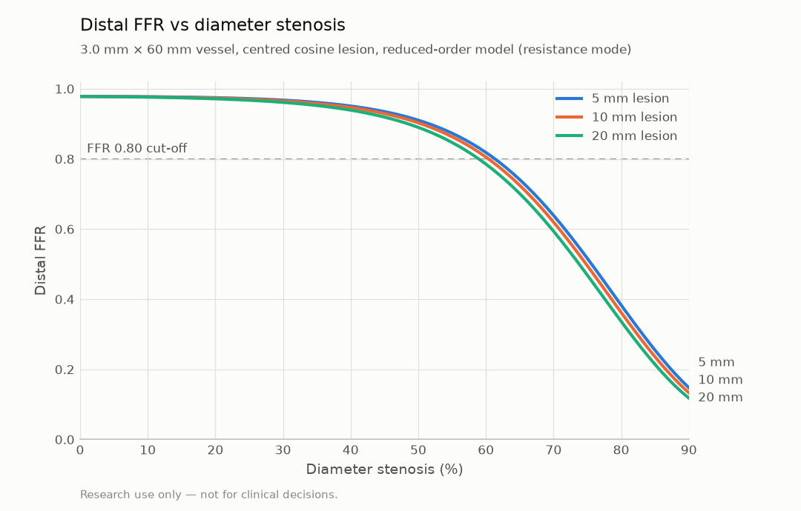

# Physics checks (reduced-order solver)

> **Research use only — not for clinical decisions.**

Generated by `vstent physics-report`. Do not edit by hand.

## Sanity checks

| Check | Value | Target | Pass |
|---|---|---|---|
| Healthy 3.0 mm × 50 mm vessel, distal FFR | 0.9819 | ≥ 0.95 | yes |
| 3.0 mm × 60 mm, 10 mm cosine lesion, 50% DS | 0.9028 | [0.84, 0.94] | yes |
| 3.0 mm × 60 mm, 10 mm cosine lesion, 70% DS | 0.6197 | [0.45, 0.70] | yes |
| Distal FFR strictly decreasing, DS 30% → 90% (5% steps) | -0.0074 | max step < 0 | yes |

## Batch solver throughput

- 49,759 profiles/s (target ≥ 5,000); batch 10,000 × 256 points, best of 5 (201.0 ms)
- CPU: AMD Ryzen 7 6800H with Radeon Graphics

## Distal FFR vs %DS

| DS (%) | 5 mm | 10 mm | 20 mm |
|---|---|---|---|
| 0 | 0.978 | 0.978 | 0.978 |
| 10 | 0.977 | 0.977 | 0.976 |
| 20 | 0.975 | 0.974 | 0.971 |
| 30 | 0.968 | 0.965 | 0.961 |
| 40 | 0.951 | 0.947 | 0.939 |
| 50 | 0.910 | 0.903 | 0.890 |
| 60 | 0.818 | 0.805 | 0.785 |
| 70 | 0.639 | 0.620 | 0.594 |
| 80 | 0.383 | 0.362 | 0.336 |
| 90 | 0.148 | 0.133 | 0.118 |

## Provenance

- git commit: `1c4c48900f2d65a4e91d322f96b166a4ef41f880` (dirty: False)
- vstent 0.1.0, generated 2026-10-26T11:25:10+00:00
- parameters: `{"mu": 0.0035, "rho": 1060.0, "pa_mmhg": 90.0, "pv_mmhg": 5.0, "kt": 1.52, "v_hyp": 0.35, "expansion_threshold": 1.05}`
