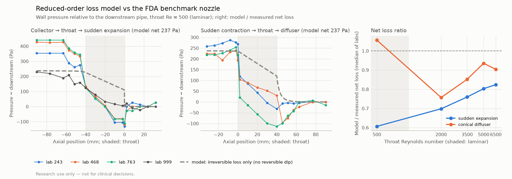

# Physics check: the FDA benchmark nozzle

> Research use only — not for clinical decisions.

The reduced-order loss model (M1: Poiseuille viscous loss + an expansion loss Kt·ρ/2·(1/A_min − 1/A_max)², Kt = 1.52) against an independent bench experiment: the U.S. FDA's benchmark nozzle, a 0.012 m pipe with a 20° cone, a 0.004 × 0.04 m throat and a sudden step (diameter stenosis 67%, area stenosis 89%), measured with wall pressure taps in three laboratories (Stewart et al. 2012; data doi:10.17917/C78G69, commit `76cdd3423845`; U.S. Government work, public domain (17 U.S.C. §105); FDA asks derived works to say so). Nothing is fitted to these data.

**Compared quantity:** the net (irreversible) pressure loss between the straight pipes upstream and downstream: the median of each laboratory's three most upstream taps minus the median of its three most downstream taps. The model has no reversible pressure dip inside the throat, so the profiles are compared only qualitatively.

## Results

SE: collector → throat → sudden expansion. CD: sudden contraction → throat → conical diffuser. Flow rates and fluid (1056 kg/m³, 3.5 mPa·s) from the data files.

| Orientation | Throat Re | Q (mL/s) | Labs | Measured net loss per lab (Pa) | Median (Pa) | Model (Pa): viscous + expansion | Model / median |
|---|---:|---:|---:|---|---:|---:|---:|
| SE | 500 | 5.21 | 4 | 353, 427, 441, 219 | 390 | 237 (128 + 109) | 0.61 |
| SE | 2000 | 20.83 | 4 | 2882, 5655, 3227, 3224 | 3226 | 2253 (512 + 1741) | 0.70 |
| SE | 3500 | 36.44 | 5 | 7534, 9830, 8224, 7801, 8199 | 8199 | 6229 (895 + 5333) | 0.76 |
| SE | 5000 | 52.06 | 4 | 15575, 18383, 14709, 13889 | 15142 | 12163 (1279 + 10884) | 0.80 |
| SE | 6500 | 67.68 | 4 | 24345, 25090, 24316, 24003 | 24330 | 20057 (1663 + 18394) | 0.82 |
| CD | 500 | 5.21 | 3 | 262, 224, 219 | 224 | 237 (128 + 109) | 1.06 |
| CD | 2000 | 20.83 | 4 | 3060, 2892, 2688, 3092 | 2976 | 2253 (512 + 1741) | 0.76 |
| CD | 3500 | 36.44 | 4 | 7157, 7457, 7217, 7405 | 7311 | 6229 (895 + 5333) | 0.85 |
| CD | 5000 | 52.06 | 4 | 12989, 15967, 12689, 13009 | 12999 | 12163 (1279 + 10884) | 0.94 |
| CD | 6500 | 67.68 | 4 | 22583, 24707, 19364, 21798 | 22190 | 20057 (1663 + 18394) | 0.90 |

## Reading the result

- **Laminar case (Re = 500), the regime of coronary stenoses** (throat Reynolds numbers of a few hundred): the model gives 237 Pa against a measured median of 390 Pa (laboratories 219–441 Pa) for the sudden expansion, a ratio of 0.61. Conical diffuser: 237 vs 224 Pa (1.06).
- **The exit shape matters, and the model cannot see it.** The model's loss depends only on the areas, so it is the same in both orientations; the measured losses differ by a factor of 1.7. An abrupt exit (sudden expansion) loses more than a gradual one (diffuser): the model is low for the first and agrees with the second.
- **Likely causes** (not separated by these data):
  - The viscous term assumes fully developed (Poiseuille) flow. The paper notes that at Re = 500 the throat flow is still developing: the entrance length, about 0.06·Re·d ≈ 0.12 m, is three times the throat. Developing flow has a higher wall shear and so a larger loss.
  - The expansion term does not depend on the expansion angle. A gradual diffuser recovers more pressure than a sudden step, so for the diffuser this term is likely too large, which may offset the viscous shortfall. That would be agreement for the wrong reason.
  - The model has no contraction loss.
- **What it means for FFR.** Coronary stenoses have throat Reynolds numbers of a few hundred, like the laminar case. For lesions with an abrupt exit the model may underestimate the pressure loss by tens of percent, and so overestimate FFR (call the lesion less severe); for gradual lesions it is closer. This is the first experimental measurement of the model's error. It is a target for the 3D CFD milestone (P6), which can quantify it on coronary geometries. Kt and the viscous term are not tuned to this experiment, and a developing-flow correction is not applied because its exact published form was not verified here.
- **Higher Reynolds numbers** (2000–6500: transitional and turbulent) are outside the model's laminar assumption and are shown for completeness.
- **Measurement spread:** the laboratories disagree by up to a factor of two at Re = 500. The paper reports a 100–250 Pa offset at Re = 500 from transducers that were not differential, and some taps are quantised in steps of about 27 Pa. Every available data set is shown.

## Data sets without usable wall pressures

- CD, Re = 500: `PIV_conical_diffuser_500_297.txt`: no wall pressures (velocity data only)
- CD, Re = 500: `PIV_conical_diffuser_500_999.txt`: no wall pressures (velocity data only)
- CD, Re = 2000: `LDV_conical_diffuser_2000_297.txt`: no wall pressures (velocity data only)
- CD, Re = 2000: `PIV_conical_diffuser_2000_999.txt`: no wall pressures (velocity data only)
- CD, Re = 3500: `PIV_conical_diffuser_3500_999.txt`: no wall pressures (velocity data only)
- CD, Re = 5000: `LDV_conical_diffuser_5000_297.txt`: no wall pressures (velocity data only)
- CD, Re = 5000: `PIV_conical_diffuser_5000_999.txt`: no wall pressures (velocity data only)
- CD, Re = 6500: `PIV_conical_diffuser_6500_999.txt`: no wall pressures (velocity data only)
- SE, Re = 500: `PIV_Sudden_Expansion_500_297.txt`: wall pressures marked deleted by the data curators
- SE, Re = 2000: `LDV_Sudden_Expansion_2000_297.txt`: no wall pressures (velocity data only)
- SE, Re = 2000: `PIV_Sudden_Expansion_2000_999.txt`: no wall pressures (velocity data only)
- SE, Re = 5000: `LDV_Sudden_Expansion_5000_297.txt`: no wall pressures (velocity data only)
- SE, Re = 5000: `PIV_Sudden_Expansion_5000_999.txt`: no wall pressures (velocity data only)
- SE, Re = 6500: `PIV_Sudden_Expansion_6500_999.txt`: no wall pressures (velocity data only)

Generated by `vstent physics-nozzle` from commit `229800e66b2cc1b4b9e259f55320567f7f4deabe` (dirty: False).
