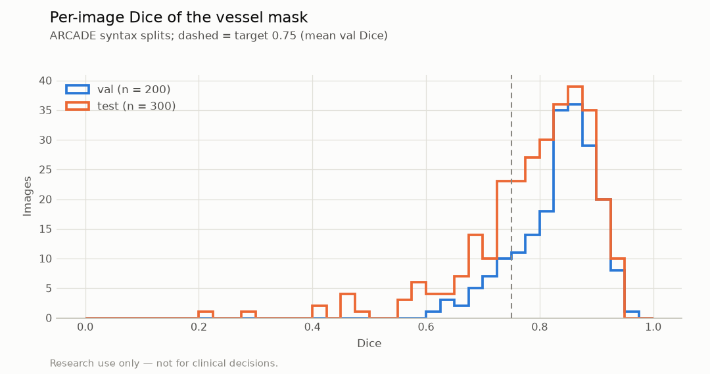
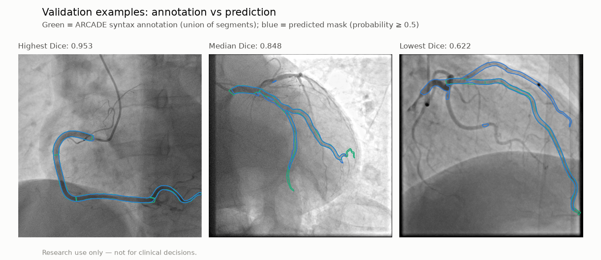
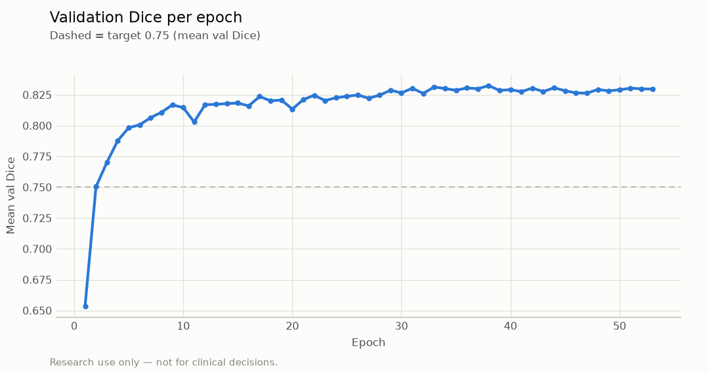

# Vessel segmentation evaluation (ARCADE)

> **Research use only — not for clinical decisions.**

Generated by `vstent eval-seg`. Do not edit by hand.

Reference masks are the union of the annotated SYNTAX segment polygons of each ARCADE `syntax` image (docs/DATA.md). Smaller side branches are not annotated, so predictions on them count as false positives. Dice per image at probability ≥ 0.5, float32, original image size.

## Target

| Metric | Value | Target | Pass |
|---|---|---|---|
| Mean val Dice (plan target; val also chose the model) | 0.8325 | ≥ 0.75 (stretch 0.8) | yes (stretch met) |
| Mean test Dice (held out) | 0.7925 | ≥ 0.75 (stretch 0.8) | yes (stretch not met) |

## Results

| Split | Images | Mean Dice | Median | 10th percentile | Min | Pixel precision | Pixel recall | Pooled Dice |
|---|---|---|---|---|---|---|---|---|
| val | 200 | 0.8325 | 0.8473 | 0.7327 | 0.6216 | 0.8409 | 0.8245 | 0.8326 |
| test | 300 | 0.7925 | 0.8183 | 0.6706 | 0.2132 | 0.8360 | 0.7676 | 0.8003 |

The test split was evaluated once, after training. Model selection (best epoch, early stopping) used val, so the val Dice is optimistic; the test Dice is the unbiased estimate.

## Figures

## Model and training

- U-Net (segmentation-models-pytorch 0.5.0), `resnet34` encoder with `imagenet` weights, 1 input channel, 512 × 512 input, 24,430,097 parameters.
- Loss BCE + 1.0 × soft Dice; AdamW lr 0.0003 with cosine decay, batch 8, up to 60 epochs, early stopping patience 15 on mean val Dice.
- Augmentation: rotation ±15°, scale 0.9–1.1, brightness ±0.1, contrast 0.8–1.2, gamma 0.8–1.25, Gaussian noise σ ≤ 0.03 (p = 0.5), CLAHE (p = 0.3); no flips.
- Best epoch 38 of 53, 27.0 min on NVIDIA GeForce RTX 3060 Laptop GPU (AMP: True); 1000 train / 200 val images.

## Provenance

- Training run `runs/seg_unet_r34-20261028-141743`, commit `0d4afee9344af03ff8a89e0dd47485b102f7dc5f` (dirty: False)
- Evaluation commit `e2459366990f9e3476f0204284d35af7eb6c6304` (dirty: False), vstent 0.1.0, 2026-10-30T15:57:00+00:00, device cuda

## Limitations

- One public dataset (ARCADE), 512 × 512 frames; no external validation.
- Masks cover only the annotated SYNTAX segments, not every visible vessel.
- Segmentation quality on other scanners, frame rates or contrast protocols is unknown.
