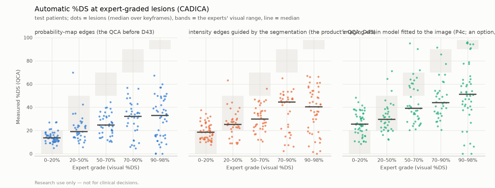

# Stenosis grading on real angiograms: CADICA expert grades

> Research use only — not for clinical decisions.

Public data, independent ground truth: the CADICA dataset (University of Málaga; Jiménez-Partinen A, Molina-Cabello MA, Thurnhofer-Hemsi K, Palomo EJ, Rodríguez-Capitán J, Molina-Ramos AI, Jiménez-Navarro M. CADICA: A new dataset for coronary artery disease detection by using invasive coronary angiography. Expert Systems 2024;41(12):e13708. Mendeley Data doi:10.17632/p9bpx9ctcv.5, CC BY 4.0 (Mendeley Data licence field)). Cine angiograms of 42 patients from a different hospital and X-ray systems than the segmentation model's training data (ARCADE), with lesion boxes and lesion grades drawn by the clinicians. The grades are **visual estimates** of diameter stenosis in ranges (0–20, 20–50, 50–70, 70–90, 90–98%, sub-total, total occlusion). Visual grading is subjective and varies between observers, so perfect agreement is not expected from any method.

**What was measured, without user input:** for every expert box on every keyframe, the frame is segmented, the vessel path crossing the box is taken from the skeleton (extended by the box size on every side for a healthy reference), and QCA gives the largest %DS inside the box. A lesion's value is the median over its keyframes. %DS needs no pixel size. Patients were split once (seed 0) into 21 development and 21 test patients; the test half is the result. The product's method was chosen on the development patients only (D43, D44).

Lumen-edge methods compared on the same paths:

- **intensity**: intensity edges guided by the segmentation (the product's QCA, D43)
- **dense**: intensity edges narrowed by densitometry (P4h), the product's domain

## Results on the test patients

Lesions graded 0–98% (ordinal categories). Intervals: 95% patient-level bootstrap. Exact / ±1: the measured %DS falls in the expert's category / within one category.

| Edge method | Measured / lesions | Weighted kappa | Spearman ρ | Exact | ±1 category | AUC ≥ 70% | AUC ≥ 50% |
|---|---:|---:|---:|---:|---:|---:|---:|
| intensity | 208 / 214 (97%) | 0.13 (0.08–0.21) | 0.43 (0.29–0.57) | 27% | 61% | 0.71 (0.62–0.80) | 0.74 (0.67–0.81) |
| dense | 208 / 214 (97%) | 0.25 (0.15–0.37) | 0.54 (0.37–0.66) | 32% | 67% | 0.77 (0.68–0.86) | 0.79 (0.69–0.86) |

Median measured %DS by expert grade (test):

| Edge method | p0_20 | p20_50 | p50_70 | p70_90 | p90_98 |
|---|---:|---:|---:|---:|---:|
| intensity | 18 | 25 | 30 | 44 | 40 |
| dense | 19 | 25 | 32 | 46 | 49 |

Confusion matrix, intensity edges (test lesions):

| Expert (rows) / measured (columns) | p0_20 | p20_50 | p50_70 | p70_90 | p90_98 |
|---|---:|---:|---:|---:|---:|
| p0_20 | 30 | 22 | 0 | 0 | 0 |
| p20_50 | 9 | 25 | 1 | 0 | 0 |
| p50_70 | 7 | 31 | 1 | 0 | 0 |
| p70_90 | 9 | 18 | 8 | 0 | 0 |
| p90_98 | 12 | 21 | 14 | 0 | 0 |

Confusion matrix, dense edges (test lesions):

| Expert (rows) / measured (columns) | p0_20 | p20_50 | p50_70 | p70_90 | p90_98 |
|---|---:|---:|---:|---:|---:|
| p0_20 | 32 | 19 | 1 | 0 | 0 |
| p20_50 | 9 | 23 | 1 | 1 | 1 |
| p50_70 | 3 | 33 | 3 | 0 | 0 |
| p70_90 | 5 | 18 | 9 | 2 | 1 |
| p90_98 | 6 | 18 | 15 | 2 | 6 |

## Development patients

| Edge method | Measured / lesions | Weighted kappa | Spearman ρ | Exact | ±1 category | AUC ≥ 70% | AUC ≥ 50% |
|---|---:|---:|---:|---:|---:|---:|---:|
| intensity | 248 / 256 (97%) | 0.21 (0.15–0.29) | 0.61 (0.47–0.70) | 36% | 71% | 0.82 (0.71–0.89) | 0.84 (0.76–0.90) |
| dense | 248 / 256 (97%) | 0.29 (0.19–0.39) | 0.60 (0.48–0.70) | 37% | 74% | 0.80 (0.70–0.89) | 0.85 (0.78–0.91) |

## Sub-total and total occlusions (all patients)

Each cell: measured / lesions, median %DS, lesions read as critical (≥ 90% DS). Last column: lesions graded 0–50% read as critical (false alarms).

| Method | Sub-total (p99) | Total (p100) | 0–50% read as critical |
|---|---:|---:|---:|
| intensity | 14 / 16, 47, 0 | 9 / 11, 7, 0 | 0 / 219 |
| dense | 14 / 16, 57, 3 | 9 / 11, 11, 0 | 1 / 219 |

A small %DS through a total occlusion means the segmentation bridged the occluded segment (or the path in the box ran through another vessel).

Generated by `vstent stenosis-grading` from commit `9ae5d52068f765e3a3414d00271c664e8f37cfc8` (dirty: False), segmentation model `models/seg/seg_unet_r34_synth-20261101-182811`. Per-lesion values: `stenosis_grading/lesions_<method>.csv`.
