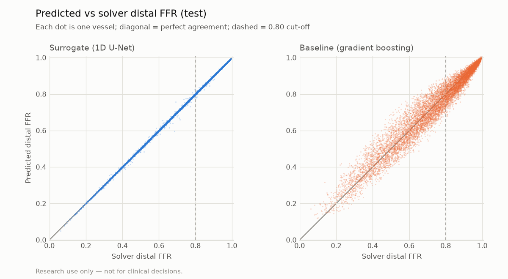
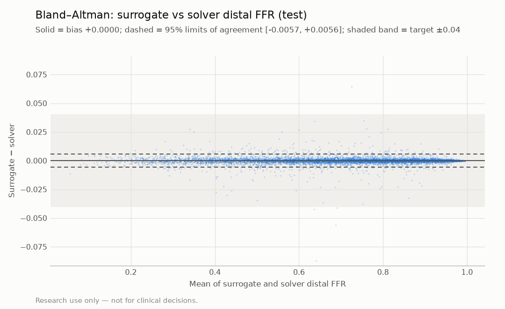
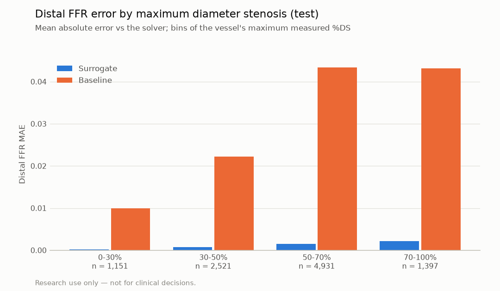
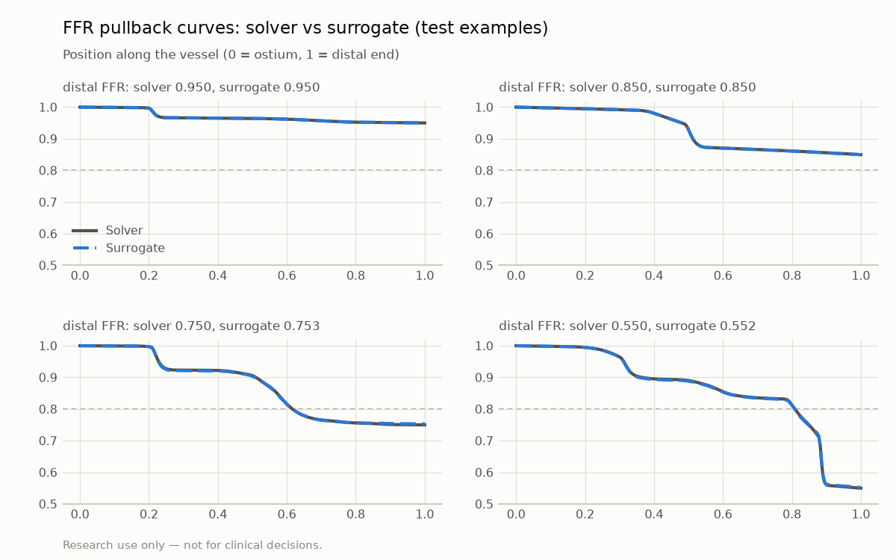
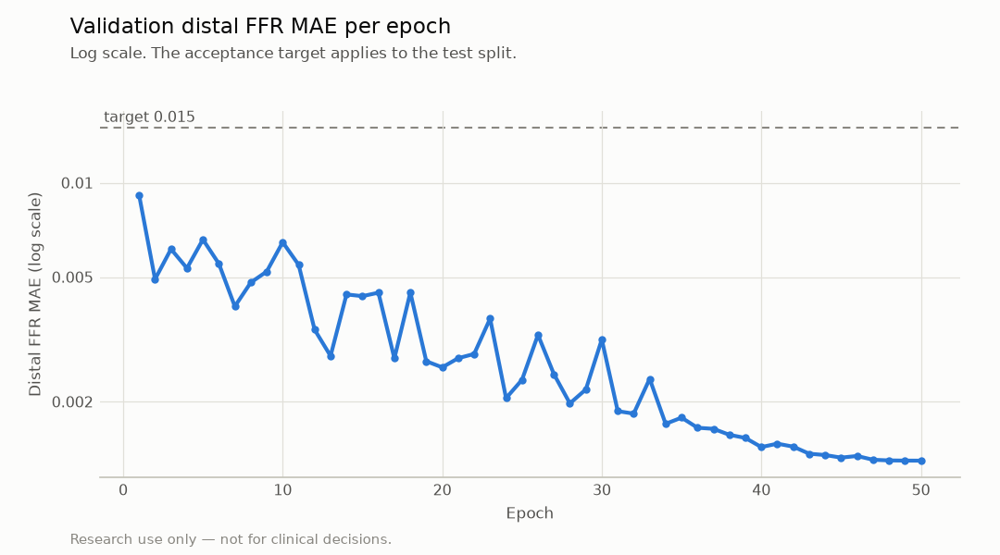

# Surrogate evaluation (1D U-Net vs reduced-order solver)

> **Research use only — not for clinical decisions.**

Generated by `vstent eval-surrogate`. Do not edit by hand.

The reference is the reduced-order solver on the same synthetic vessels; these numbers measure how well the surrogate reproduces that model, not clinical accuracy. In this MVP the solver is already fast: the surrogate validates the training → ONNX → app pipeline for Phase 2 (3D-CFD labels). No speed-up over the solver is claimed.

## Acceptance targets (test split)

| Metric | Value | Target | Pass |
|---|---|---|---|
| Distal FFR MAE | 0.0013 | ≤ 0.015 | yes |
| 95% limits of agreement | [-0.0057, +0.0056] | within ±0.04 | yes |
| Agreement at 0.8 | 99.76% | ≥ 97% | yes |

## Distal FFR metrics

Positive class for sensitivity / specificity: FFR < 0.80 according to the solver.

| Split | Model | n | MAE | Bias | 95% LoA | Agreement | Sens. | Spec. | Max error | Curve MAE |
|---|---|---|---|---|---|---|---|---|---|---|
| val | surrogate | 10,000 | 0.0013 | +0.0000 | [-0.0057, +0.0056] | 99.80% | 99.80% | 99.80% | 0.074 | 0.0009 |
| val | baseline | 10,000 | 0.0341 | +0.0004 | [-0.0900, +0.0909] | 93.14% | 93.91% | 92.23% | 0.223 | n/a |
| test | surrogate | 10,000 | 0.0013 | +0.0000 | [-0.0057, +0.0056] | 99.76% | 99.80% | 99.72% | 0.087 | 0.0009 |
| test | baseline | 10,000 | 0.0342 | -0.0008 | [-0.0906, +0.0891] | 93.39% | 94.54% | 92.05% | 0.192 | n/a |
| ood | surrogate | 5,000 | 0.0039 | +0.0002 | [-0.0115, +0.0118] | 99.90% | 99.96% | 98.48% | 0.070 | 0.0030 |
| ood | baseline | 5,000 | 0.0505 | +0.0086 | [-0.1145, +0.1316] | 96.92% | 97.83% | 74.62% | 0.223 | n/a |

`ood` = 80–120 mm vessels with 3–4 lesions, outside the training distribution (reported, no target).

## Error by stenosis severity (test)

| Max DS bin | n | Surrogate MAE | Baseline MAE |
|---|---|---|---|
| 0-30% | 1,151 | 0.0002 | 0.0099 |
| 30-50% | 2,521 | 0.0008 | 0.0223 |
| 50-70% | 4,931 | 0.0016 | 0.0434 |
| 70-100% | 1,397 | 0.0021 | 0.0431 |

## Figures

## Training

- Run `runs/unet1d-20261028-125810`: 1,058,881 parameters, 100,000 train / 10,000 val samples, best epoch 50 of 50, 12.8 min on NVIDIA GeForce RTX 3060 Laptop GPU (AMP: True).
- Baseline: histogram gradient boosting on max DS, lesion length (DS > 30%), D0, L, Pa, R_micro, fitted in 0.8 s.

## Provenance

- Training run commit: `deb7b35a42b322302b89ddfbc0e03a45bb21e4f1` (dirty: False)
- Evaluation commit: `4e93e889358c2a8810ae5cc0abc97413e747aee1` (dirty: False), vstent 0.1.0, 2026-10-28T13:13:18+00:00

## Limitations

- Synthetic single-vessel data only; labels come from the reduced-order model.
- Accuracy on real angiography-derived profiles (M5) is not measured here.
