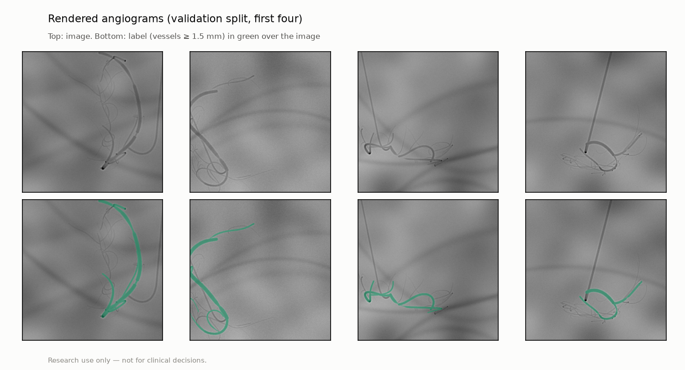

# Rendered angiograms: dataset card (P8 sim-to-real)

> **Research use only — not for clinical decisions.**

Generated by `vstent synth-angio`. Do not edit by hand. Synthetic images, not clinical data.

One or two synthetic coronary trees from one ostium (P2 lumen profiles on a heart-sized sphere, P5), one random clinical view, the ARCADE-fitted X-ray chain (D39). Drawn but not labelled: small branches, a contrast-filled catheter, anatomy-like shadows, rib-like bands, vignetting. **Label:** the lumen of every vessel whose reference diameter is ≥ 1.5 mm (pre-registered; ARCADE annotates its SYNTAX segments, which is not the same set).

| Split | Images | Two trees | Labelled vessels | Unlabelled tree branches | Small branches | Catheter | Labelled pixels | SHA-256 (images + masks) |
|---|---:|---:|---:|---:|---:|---:|---:|---|
| train | 2000 | 59% | 4.1 | 2.2 | 20.9 | 91% | 2.6% | `9f4f3cced035c67b…` |
| val | 200 | 66% | 4.4 | 2.2 | 20.2 | 93% | 2.8% | `7e64a844ecded0be…` |
| test | 200 | 70% | 4.3 | 2.6 | 20.4 | 90% | 2.8% | `45953f79ccb8b449…` |

Config `synth_angio_v1` (seed 8001; seeds per split in the manifest). Commit `7c7b74fb3b2f4b303a6144be6087c22a45477191` (dirty: False).
