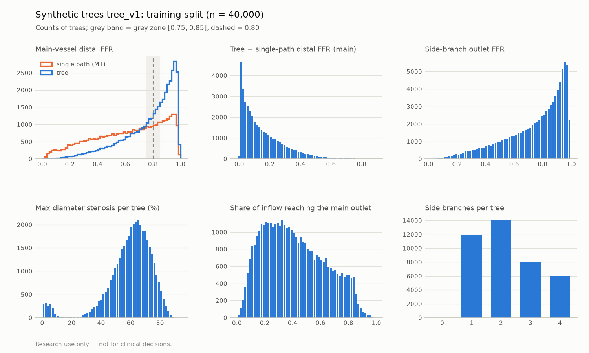

# Dataset card: synthetic vessel trees tree_v1

> **Research use only — not for clinical decisions.** Synthetic data only; no patient data.

Generated by `vstent synth-tree`. Do not edit by hand.

## What it is

A main coronary-like vessel with 1–4 side branches, each a radius profile on 256 points. The main vessel steps down after every take-off (Murray-like). Lesions use the single-vessel shapes (cosine, skewed_cosine, plateau, irregular), including *bifurcation* lesions centred on a take-off and *ostial* side-branch lesions. Labels come from the tree solver (docs/PHYSICS.md, *Vessel trees*) on exactly the stored float32 radii: FFR at every sample of every branch, outlet and inlet flows, and outlet resistances. The single-path FFR of the main vessel alone (M1 solver, same Pa, Pv and v_hyp) is stored for comparison. Sampling ranges: `config.yaml` next to the data (copy of `configs/synth_tree_v1.yaml`).

## Acceptance targets (in-distribution splits; main-vessel distal FFR, tree solver)

| Split | FFR < 0.80 | Target | Grey zone [0.75, 0.85] | Target | Pass |
|---|---|---|---|---|---|
| train | 43.9% | ≥ 30% | 19.3% | ≥ 15% | yes |
| val | 44.6% | ≥ 30% | 19.0% | ≥ 15% | yes |
| test | 43.1% | ≥ 30% | 18.0% | ≥ 15% | yes |
| cal | 42.6% | ≥ 30% | 18.1% | ≥ 15% | yes |

## Splits

Values are median [5th, 95th percentile]. *Tree − single* is the main-vessel distal FFR of the tree minus that of the main vessel alone.

| Split | n | Seed | Side branches 1/2/3/4 | Main FFR (tree) | FFR < 0.80 (tree) | Main FFR (single path) | FFR < 0.80 (single) | Tree − single | Any outlet < 0.80 | Side outlet FFR | Max DS (%) | Clamped outlets |
|---|---|---|---|---|---|---|---|---|---|---|---|---|
| train | 40,000 | 2001 | 11995/14051/7985/5969 | 0.830 [0.387, 0.972] | 43.9% | 0.658 [0.167, 0.955] | 68.9% | 0.109 [0.006, 0.444] | 74.7% | 0.807 [0.320, 0.971] | 61.8 [30.6, 78.8] | 37 |
| val | 4,000 | 2002 | 1147/1413/820/620 | 0.826 [0.378, 0.973] | 44.6% | 0.657 [0.152, 0.957] | 69.1% | 0.111 [0.006, 0.445] | 75.4% | 0.801 [0.320, 0.970] | 61.8 [31.3, 78.4] | 11 |
| test | 4,000 | 2003 | 1201/1385/810/604 | 0.836 [0.387, 0.972] | 43.1% | 0.660 [0.159, 0.954] | 66.9% | 0.107 [0.006, 0.449] | 74.0% | 0.807 [0.327, 0.972] | 62.0 [30.1, 78.6] | 2 |
| cal | 4,000 | 2005 | 1208/1341/828/623 | 0.840 [0.387, 0.973] | 42.6% | 0.661 [0.157, 0.957] | 67.3% | 0.110 [0.006, 0.461] | 74.2% | 0.809 [0.311, 0.971] | 61.8 [25.2, 78.8] | 4 |
| ood | 2,000 | 2004 | 0/0/0/2000 | 0.620 [0.223, 0.867] | 84.7% | 0.224 [0.045, 0.645] | 99.2% | 0.315 [0.099, 0.594] | 98.2% | 0.699 [0.222, 0.962] | 67.1 [51.4, 80.5] | 22 |

Lesions (train): regular 78,805, bifurcation 10,111, ostial 13,103. Trees where the tree's main distal FFR is below the single path's: 0.1% (train). This can happen when a proximal lesion is followed by distal disease: the side branches keep drawing flow through the proximal lesion, which the single path cannot represent.

## Distributions (train)

## Generation

- 54,000 trees in 13.4 s with 12 worker processes on AMD Ryzen 7 6800H with Radeon Graphics
- git commit: `fd1dfcab73623562e550f85dbd12a5f64c837f00` (dirty: False), vstent 0.1.0, generated 2026-10-30T15:41:15+00:00
- Reproducible: shard seeds are (split seed, shard index), independent of the number of workers; per-shard content SHA-256 hashes are in `manifest.json`.

## Limitations

- Geometry is synthetic and idealised: straight branches, circular lumen, one level of side branches, no overlap.
- Labels are reduced-order outputs (Murray split, no junction losses), not 3D CFD or invasive FFR.
- `ood` (100–140 mm main vessel, 4 side branches, 2–3 main lesions) is out of distribution by design; it has no targets.
