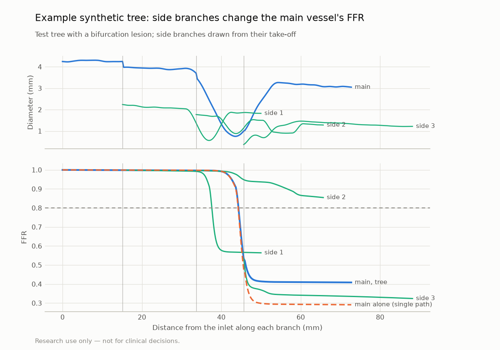

# Tree physics checks (P2)

> **Research use only — not for clinical decisions.**

Generated by `vstent tree-report`. Do not edit by hand. Model: docs/PHYSICS.md, *Vessel trees*; data: `reports/tree_dataset_card.md`.

## Sanity checks

| Check | Result | Tolerance | Pass |
|---|---|---|---|
| One-branch tree = single-vessel (M1) solver, 200 sampled vessels | max abs FFR difference 4.4e-16 | ≤ 1e-10 | yes |
| Mass conserved at every junction, 1000 test trees | max relative residual 2.9e-16 | ≤ 1e-9 | yes |
| Pressure continuous at every take-off | max gap 0.0e+00 × Pa | ≤ 1e-9 | yes |
| Every outlet: P − Pv = R·q | max relative residual 2.1e-14 | ≤ 1e-9 | yes |
| Healthy trees split flow by Murray's law (k = 2.33), 2,206 junctions in 999 trees (1 with an outlet resistance at its floor excluded) | max relative error 8.9e-16 | ≤ 1e-9 | yes |
| A side branch upstream of a lesion raises distal main FFR (9 controlled cases) | smallest increase 0.0071 | > 0 | yes |
| A side branch carrying almost no flow inside a lesion's expansion leaves the main vessel unchanged | max abs FFR difference 2.0e-05 | ≤ 2e-4 | yes |

## Throughput

| Metric | Value | Target | Pass |
|---|---|---|---|
| Trees per second, one process (1,000 test trees, mean 3.2 branches) | 3,474 | ≥ 1,000 | yes |

CPU: AMD Ryzen 7 6800H with Radeon Graphics. One batched call (padded Newton, ~5 iterations), median of 3 runs.

## Side-branch effect (controlled cases)

Main vessel 70 mm, 3.0 mm, lesion centred at 50 mm; side branch from 20 mm.

| Lesion severity | Side / main diameter | FFR, main alone | FFR, with side branch | Increase |
|---|---|---|---|---|
| 40% | 0.4 | 0.943 | 0.950 | +0.007 |
| 40% | 0.6 | 0.943 | 0.958 | +0.015 |
| 40% | 0.8 | 0.943 | 0.966 | +0.023 |
| 60% | 0.4 | 0.801 | 0.827 | +0.025 |
| 60% | 0.6 | 0.801 | 0.857 | +0.056 |
| 60% | 0.8 | 0.801 | 0.890 | +0.089 |
| 80% | 0.4 | 0.358 | 0.386 | +0.028 |
| 80% | 0.6 | 0.358 | 0.427 | +0.069 |
| 80% | 0.8 | 0.358 | 0.485 | +0.126 |

## Example

Test tree 2 (4 branches): main-vessel distal FFR 0.409 as a tree vs 0.291 as a single path.

## Limitations

- Junction losses are neglected; the healthy flow split follows Murray's law, not measured territories.
- These checks verify the implementation against its own equations; agreement with 3D CFD or invasive FFR is not tested here (P4, P6).

## Provenance

- Commit `76140d30470908c482855ef179ab2f0191a68683` (dirty: False), vstent 0.1.0, 2026-10-30T16:02:11+00:00; data `data/synth/tree_v1`.
