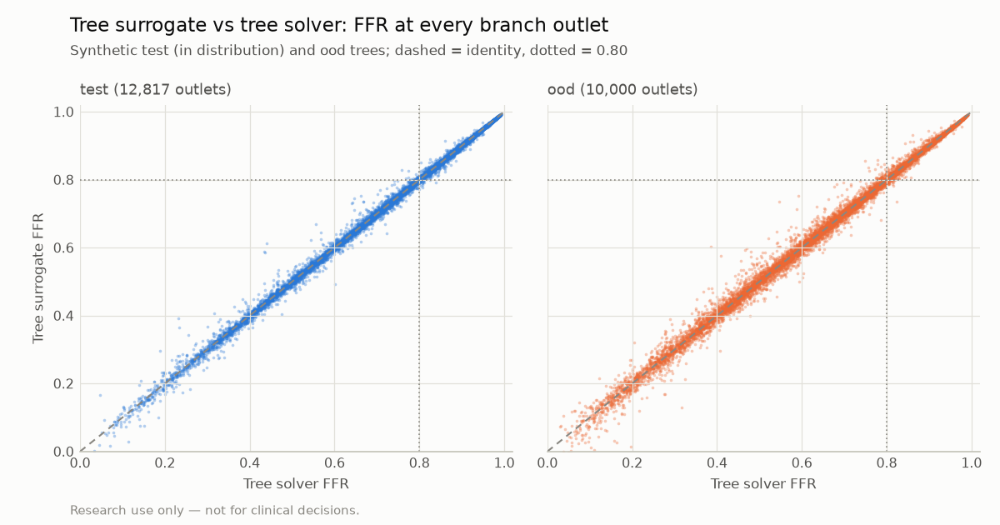

# Tree surrogate evaluation (P3)

> **Research use only — not for clinical decisions.**

Generated by `vstent eval-tree-surrogate`. Do not edit by hand. Errors are FFR differences to the tree solver (docs/PHYSICS.md, *Vessel trees*) on synthetic trees (`reports/tree_dataset_card.md`), not to invasive FFR.

## Targets (test trees)

| Metric | Value | Target | Pass |
|---|---|---|---|
| MAE, every sample of every branch (node-wise) | 0.0038 | ≤ 0.015 | yes |
| MAE at every outlet (distal) | 0.0043 | ≤ 0.015 | yes |

FFR(0) = 1 at the inlet, continuity at every junction and monotone decrease along every path hold by construction (the model's tree head).

## All metrics

| Metric | test | ood |
|---|---|---|
| Trees / branches | 4,000 / 12,817 | 2,000 / 10,000 |
| MAE, every sample of every branch | 0.0038 | 0.0090 |
| Max error, any sample | 0.281 | 0.286 |
| MAE at every outlet | 0.0043 | 0.0094 |
| 95th percentile / max error at outlets | 0.0157 / 0.234 | 0.0321 / 0.218 |
| MAE at the main outlet | 0.0046 | 0.0105 |
| MAE at side outlets | 0.0041 | 0.0091 |
| Outlets: agreement at 0.80 (sensitivity / specificity / accuracy) | 0.992 / 0.994 / 0.993 | 0.990 / 0.986 / 0.989 |
| For context: main outlet, single-path solver vs tree solver (MAE) | 0.1522 | 0.3257 |

By number of side branches (test): 1: 1,201 trees, outlet MAE 0.0040; 2: 1,385 trees, outlet MAE 0.0040; 3: 810 trees, outlet MAE 0.0043; 4: 604 trees, outlet MAE 0.0050.

## Training

Run `runs/tree_unet-20261030-191415`: 50 epochs, best at epoch 50 (val outlet MAE 0.0043), 23 min on NVIDIA GeForce RTX 3060 Laptop GPU, 1,308,737 parameters.

## Limitations

- Agreement with the tree solver only; the solver's own error against 3D CFD or wire FFR is not measured here (P4, P6).
- At most 5 branches (main + 4 side branches) of 256 samples each; image trees with more branches fall back to the solver.
- `ood` trees (100–140 mm main vessel, 4 side branches) are outside the training ranges.

Evaluation commit `af2c87cd20c78cf9a80ceec1d632f849cd2dd6b6` (dirty: False), vstent 0.1.0, 2026-10-30T19:38:21+00:00.
