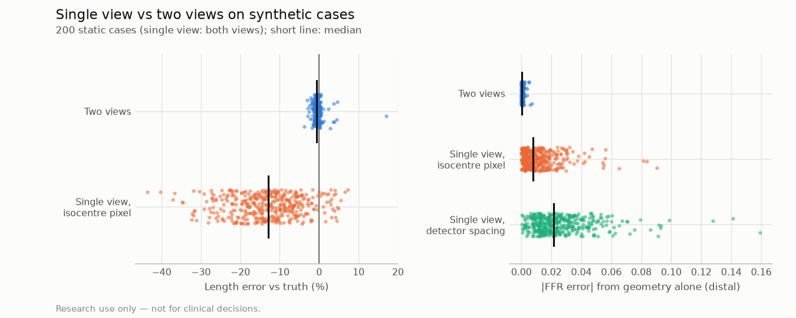
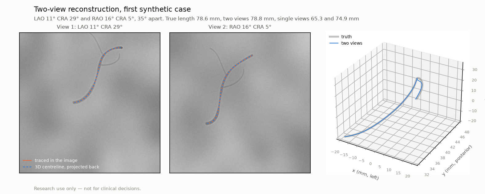

# Two-view 3D reconstruction on synthetic angiograms (P5)

> **Research use only — not for clinical decisions.**

Generated by `vstent two-view-synthetic`. Do not edit by hand.

200 synthetic coronary trees (P2 lumen profiles with lesions and side branches) laid on a heart-sized sphere, each seen in two C-arm views and rendered as X-ray-like images with the ARCADE-fitted contrast, blur, edge enhancement and noise (D39). The views are chosen as QCA practice asks: the analysed vessel overlaps neither itself nor a side branch; foreshortening is not avoided. Each case is analysed with the product's own steps: the centreline between the clicked start and end points (1 px click error), QCA with intensity edges, then the two-view reconstruction (D49) with its motion correction. Single-view QCA of each view is the comparison, with the pixel size at the isocentre (from the DICOM geometry, P5) and with the uncorrected detector spacing (what the loader offered before P5). FFR: the reduced-order solver (default physics) on each profile and on the true lumen.

**Caveats.** The images are rendered with the same projection model the reconstruction uses, so the errors of a real C-arm are not tested: the angle convention (D49, to be confirmed on real two-view DICOM), isocentre and calibration errors, image distortion, and non-rigid motion (two runs at different cardiac phases). The segmentation stand-in is the rendered vessel. This is the method's best case on known geometry; real two-view data are needed next.

| Target | Value | Required | Status |
|---|---|---|---|
| 3D centreline error, median over cases of the per-case mean (mm) | 0.20 | ≤ 1 | PASS |
| Length error, median over cases of |error| (%) | 0.7 | ≤ 5% | PASS |
| Check: share of |length error| > 5% flagged (P5b) | 0% (0 of 1) | ≥ 80% | FAIL |
| Check: share of all cases flagged (P5b) | 18% | ≤ 10% | FAIL |

Cases: 200; the analysis failed in 0 (counted as infinite error). The views were 49° apart (median), and the true vessel length was 65 mm (median).

## Length: one view vs two views

Foreshortening makes a single view read a vessel shorter than it is, and the pixel size at the isocentre is exact only for vessels at the isocentre's depth: here it was 4.3% off at the vessel (median abs.; 90th pct 7.0%), with the heart within 15 mm (SD per axis) of the isocentre.

| Method | Median abs. error (%) | 90th pct (%) | Median signed (%) | Within 5% |
|---|---:|---:|---:|---:|
| Single view, detector spacing (no magnification correction) | 20.2 | 39.1 | – | – |
| Single view, isocentre pixel size | 13.0 | 24.6 | -13.0 | 14.8% |
| Two views | 0.7 | 1.8 | -0.6 | 99.5% |

1 of 200 cases were off by more than 5%; the check flagged 0 of them:

- seed 7084: +17.0% (3.1 mm 3D error), views 42° apart, single views -7%, -12%; not flagged

Warnings on 35 of 200 cases, 21 of them from the reliability check (D50: the length changes by more than 2.5% with smoother fitting, or the 3D path departs from a traced path by more than 0.30 px), the others from views close together or a vessel running mostly along the epipolar lines. Median abs. length error 1.0% in flagged cases, 0.6% in the others.

## FFR error from the geometry alone

The true lumen seen through each method's geometry with a perfect measurement in pixels: the length is the method's, and each radius is scaled by the pixel size the method uses over the true pixel size at that point. This isolates what the geometry costs.

| Method | abs. FFR error, median | 90th pct | max |
|---|---:|---:|---:|
| Single view, detector spacing | 0.021 | 0.048 | 0.159 |
| Single view, isocentre pixel size | 0.008 | 0.025 | 0.090 |
| Two views | 0.000 | 0.001 | 0.007 |

## Diameter and FFR end to end

With the product's lumen measurement (intensity edges) in each view.

| Method | Reference diameter, median abs. error (%) | Lumen diameter MAE, median (mm) | abs. FFR error, median | abs. FFR error, 90th pct |
|---|---:|---:|---:|---:|
| Single view, detector spacing | 31.9 | – | 0.069 | 0.408 |
| Single view, isocentre pixel size | 6.5 | 0.21 | 0.064 | 0.398 |
| Two views | 4.3 | 0.15 | 0.057 | 0.383 |

The lumen is the product default (scaled: intensity edges for the shape, the imaging-chain fit for the absolute size, P5b). Intensity edges alone sit inside the blurred, edge-enhanced wall: in one view they read the reference diameter -15.8% off (median signed), the scaled lumen -3.4% (size factor median 1.156; refused in 31 of 400 views). End-to-end FFR error in one view: 0.067 with edges alone, 0.064 scaled (median). The remaining FFR error comes mainly from tight lesions, which edges read milder than they are (P4c). Same solver and physics throughout; the true lumen is not trimmed at its ends, the QCA profiles are (one diameter at each end, where the synthetic vessels have no lesion).

## Motion between the runs

The same cases with the heart shifted between the two runs (median 3.1 mm; SD 2 mm per axis). A shift across the epipolar lines is estimated from the vessel itself. A shift along them cannot be seen in two views: it moves the reconstruction with little change of shape (shape error: after removing the best translation).

| Reconstruction | Median abs. length error (%) | 90th pct (%) | 3D error, median (mm) | Shape error, median (mm) | abs. FFR error, median | Flagged by the check |
|---|---:|---:|---:|---:|---:|---:|
| No motion, no correction | 0.7 | 1.6 | 0.14 | – | – | – |
| No motion, with correction (default) | 0.7 | 1.8 | 0.20 | – | 0.057 | 35 of 200 |
| Motion, no correction | 2.1 | 21.4 | 2.60 | 1.04 | 0.064 | 105 of 200 |
| Motion, with correction (default) | 0.8 | 2.1 | 1.76 | 0.17 | 0.056 | 33 of 200 |

## Stress test: random views, overlap allowed

50 further cases with random views (not chosen to avoid overlap); in 42 of them the analysed vessel overlaps itself or a side branch in a view. The analysis failed in 0. Where vessels cross, the shortest path along the segmentation can follow the wrong vessel; when the wrong path still fits the other view, the check does not notice it. The analyst must choose views in which the segment does not overlap, or correct the path.

| Views | Cases | Two views: median abs. length error (%) | 90th pct (%) | 3D error, median (mm) | 3D error, 90th pct (mm) | Single view: median abs. length error (%) |
|---|---:|---:|---:|---:|---:|---:|
| No overlap | 8 | 0.4 | 1.0 | 0.22 | 0.40 | 17.2 |
| Overlap | 42 | 1.0 | 11.9 | 0.31 | 3.84 | 22.3 |

Per case (static)

| Seed | Views | Apart (°) | Length (mm) | Two views: length error (%) | 3D error (mm) | True FFR | Two views FFR | Single view FFR (view 1, 2) |
|---:|---|---:|---:|---:|---:|---:|---:|---|
| 7001 | LAO 11° CRA 29° / RAO 16° CRA 5° | 35 | 78.6 | +0.3 | 0.25 | 0.821 | 0.753 | 0.781, 0.759 |
| 7002 | LAO 33° CAU 27° / RAO 13° CRA 21° | 65 | 65.9 | -0.0 | 0.12 | 0.867 | 0.839 | 0.868, 0.771 |
| 7003 | RAO 3° CAU 29° / RAO 17° CRA 34° | 65 | 65.7 | -0.5 | 0.17 | 0.807 | 0.777 | 0.791, 0.819 |
| 7004 | LAO 41° CAU 14° / LAO 2° CAU 7° | 39 | 75.2 | +2.8 | 0.55 | 0.928 | 0.928 | 0.926, 0.926 |
| 7005 | RAO 12° CRA 11° / RAO 32° CAU 17° | 34 | 49.2 | -0.4 | 0.13 | 0.969 | 0.965 | 0.969, 0.965 |
| 7006 | LAO 10° CAU 34° / RAO 1° CRA 7° | 42 | 57.0 | +0.4 | 0.19 | 0.783 | 0.787 | 0.740, 0.796 |
| 7007 | RAO 43° CRA 4° / LAO 12° CAU 16° | 58 | 45.8 | -1.1 | 0.20 | 0.883 | 0.883 | 0.920, 0.870 |
| 7008 | LAO 57° CRA 5° / RAO 3° CAU 20° | 64 | 83.8 | -0.5 | 0.14 | 0.331 | 0.231 | 0.551, 0.346 |
| 7009 | LAO 36° CAU 4° / LAO 27° CRA 36° | 41 | 63.4 | -0.3 | 0.10 | 0.735 | 0.738 | 0.794, 0.524 |
| 7010 | RAO 24° CRA 5° / LAO 41° CAU 23° | 69 | 49.5 | -0.9 | 0.13 | 0.482 | 0.702 | 0.721, 0.704 |
| 7011 | LAO 4° CAU 12° / LAO 41° CAU 29° | 38 | 83.7 | -0.9 | 0.18 | 0.395 | 0.471 | 0.494, 0.471 |
| 7012 | RAO 31° CRA 12° / LAO 31° CAU 22° | 70 | 68.0 | -0.9 | 0.12 | 0.471 | 0.858 | 0.844, 0.869 |
| 7013 | RAO 8° CRA 37° / RAO 28° CRA 12° | 31 | 69.2 | -0.5 | 0.17 | 0.612 | 0.866 | 0.056, 0.056 |
| 7014 | RAO 42° CAU 34° / LAO 7° CRA 12° | 66 | 67.1 | +1.1 | 0.27 | 0.149 | 0.311 | 0.107, 0.852 |
| 7015 | LAO 11° CRA 26° / LAO 24° CAU 2° | 30 | 50.7 | -1.3 | 0.32 | 0.823 | 0.926 | 0.919, 0.908 |
| 7016 | RAO 35° CRA 31° / RAO 28° CAU 8° | 40 | 68.4 | -0.8 | 0.21 | 0.940 | 0.933 | 0.935, 0.922 |
| 7017 | RAO 20° CAU 7° / RAO 33° CRA 29° | 37 | 62.4 | -1.1 | 0.21 | 0.906 | 0.977 | 0.977, 0.928 |
| 7018 | RAO 19° CAU 16° / LAO 24° CRA 11° | 50 | 83.4 | -0.6 | 0.19 | 0.764 | 0.695 | 0.658, 0.659 |
| 7019 | LAO 15° CRA 23° / LAO 55° CRA 7° | 42 | 51.9 | -0.9 | 0.28 | 0.595 | 0.652 | 0.639, 0.643 |
| 7020 | RAO 19° CAU 31° / LAO 56° CRA 1° | 77 | 74.6 | -0.3 | 0.11 | 0.861 | 0.798 | 0.850, 0.750 |
| 7021 | LAO 53° CRA 23° / LAO 10° CAU 25° | 63 | 88.0 | -0.6 | 0.07 | 0.977 | 0.979 | 0.979, 0.981 |
| 7022 | LAO 24° CAU 25° / LAO 54° CRA 36° | 68 | 62.3 | -1.2 | 0.21 | 0.667 | 0.683 | 0.784, 0.575 |
| 7023 | RAO 18° CRA 30° / LAO 10° CRA 6° | 36 | 76.4 | +4.5 | 0.58 | 0.616 | 0.256 | 0.551, 0.060 |
| 7024 | LAO 12° CRA 11° / LAO 31° CRA 37° | 31 | 70.9 | -0.6 | 0.16 | 0.931 | 0.926 | 0.921, 0.927 |
| 7025 | RAO 26° CRA 23° / LAO 9° CRA 2° | 40 | 84.2 | -0.5 | 0.27 | 0.802 | 0.783 | 0.801, 0.730 |
| 7026 | LAO 52° CRA 39° / RAO 2° CRA 24° | 48 | 43.3 | +0.0 | 1.29 | 0.468 | 0.197 | 0.494, 0.072 |
| 7027 | RAO 5° CAU 3° / LAO 24° CRA 35° | 47 | 59.1 | -2.4 | 0.29 | 0.760 | 0.113 | 0.082, 0.066 |
| 7028 | LAO 10° CAU 17° / RAO 29° CRA 26° | 57 | 68.1 | -0.7 | 0.13 | 0.438 | 0.678 | 0.705, 0.647 |
| 7029 | LAO 5° CRA 4° / RAO 15° CAU 33° | 42 | 68.1 | -0.2 | 0.29 | 0.685 | 0.710 | 0.666, 0.773 |
| 7030 | LAO 34° CAU 17° / LAO 10° CRA 31° | 54 | 47.6 | -0.6 | 0.37 | 0.848 | 0.870 | 0.827, 0.893 |
| 7031 | RAO 19° CAU 24° / RAO 8° CRA 33° | 58 | 62.1 | -1.1 | 0.28 | 0.821 | 0.793 | 0.711, 0.812 |
| 7032 | LAO 51° CAU 26° / RAO 26° CRA 12° | 83 | 78.2 | -0.5 | 0.14 | 0.779 | 0.909 | 0.890, 0.932 |
| 7033 | LAO 29° CRA 10° / RAO 22° CRA 29° | 51 | 59.3 | -1.2 | 0.16 | 0.744 | 0.777 | 0.742, 0.803 |
| 7034 | LAO 17° CAU 14° / RAO 20° CAU 2° | 39 | 66.5 | -0.9 | 0.08 | 0.521 | 0.520 | 0.467, 0.560 |
| 7035 | LAO 18° CAU 30° / LAO 48° CRA 28° | 65 | 55.7 | -0.9 | 0.40 | 0.478 | 0.849 | 0.794, 0.761 |
| 7036 | LAO 37° CAU 33° / LAO 48° CRA 13° | 47 | 44.9 | -0.4 | 0.13 | 0.953 | 0.962 | 0.961, 0.967 |
| 7037 | LAO 8° CRA 18° / RAO 26° CRA 25° | 32 | 86.5 | +0.3 | 0.18 | 0.283 | 0.433 | 0.427, 0.453 |
| 7038 | RAO 5° CRA 21° / RAO 10° CAU 17° | 39 | 52.5 | +0.1 | 0.08 | 0.508 | 0.432 | 0.415, 0.344 |
| 7039 | LAO 43° CAU 18° / RAO 5° CAU 26° | 45 | 66.9 | -1.1 | 0.28 | 0.967 | 0.969 | 0.980, 0.975 |
| 7040 | LAO 27° CAU 9° / RAO 8° CAU 22° | 35 | 81.7 | +0.1 | 0.16 | 0.187 | 0.681 | 0.694, 0.505 |
| 7041 | RAO 45° CRA 32° / RAO 21° CAU 32° | 68 | 80.0 | -0.7 | 0.20 | 0.818 | 0.435 | 0.357, 0.474 |
| 7042 | LAO 26° CAU 18° / RAO 15° CRA 34° | 65 | 57.2 | -1.3 | 0.17 | 0.361 | 0.492 | 0.469, 0.408 |
| 7043 | RAO 12° CRA 17° / RAO 38° CAU 6° | 34 | 87.7 | -1.0 | 0.23 | 0.700 | 0.651 | 0.564, 0.557 |
| 7044 | LAO 40° CRA 26° / LAO 2° CAU 16° | 56 | 81.6 | -0.5 | 0.23 | 0.803 | 0.794 | 0.799, 0.822 |
| 7045 | LAO 9° CAU 29° / LAO 23° CRA 35° | 65 | 71.9 | -0.3 | 0.10 | 0.798 | 0.792 | 0.760, 0.800 |
| 7046 | RAO 1° CRA 3° / LAO 45° CRA 3° | 46 | 61.7 | -0.7 | 0.10 | 0.518 | 0.943 | 0.409, 0.958 |
| 7047 | RAO 23° CRA 21° / LAO 34° CRA 25° | 52 | 61.3 | -1.4 | 0.16 | 0.515 | 0.907 | 0.915, 0.906 |
| 7048 | LAO 16° CAU 7° / LAO 36° CRA 23° | 36 | 52.6 | -2.6 | 0.80 | 0.384 | 0.057 | 0.057, 0.057 |
| 7049 | RAO 1° CAU 28° / LAO 29° CRA 24° | 60 | 80.2 | -0.6 | 0.21 | 0.585 | 0.915 | 0.917, 0.880 |
| 7050 | RAO 35° CRA 34° / LAO 24° CAU 9° | 70 | 71.3 | -1.0 | 0.12 | 0.296 | 0.639 | 0.703, 0.514 |
| 7051 | LAO 34° CRA 14° / RAO 5° CRA 13° | 38 | 56.4 | -0.7 | 0.12 | 0.670 | 0.698 | 0.669, 0.780 |
| 7052 | RAO 21° CAU 33° / RAO 36° CRA 20° | 54 | 71.7 | -0.4 | 1.60 | 0.818 | 0.912 | 0.883, 0.926 |
| 7053 | RAO 21° CAU 0° / LAO 16° CAU 35° | 49 | 75.3 | -1.2 | 0.11 | 0.639 | 0.830 | 0.835, 0.845 |
| 7054 | LAO 19° CAU 30° / RAO 18° CRA 3° | 49 | 50.0 | +0.3 | 0.16 | 0.362 | 0.786 | 0.736, 0.769 |
| 7055 | RAO 41° CRA 0° / LAO 32° CRA 39° | 76 | 77.9 | -1.2 | 0.10 | 0.828 | 0.816 | 0.828, 0.804 |
| 7056 | LAO 45° CAU 12° / RAO 32° CRA 26° | 84 | 86.0 | -0.0 | 0.11 | 0.382 | 0.676 | 0.716, 0.581 |
| 7057 | LAO 7° CAU 31° / LAO 58° CRA 13° | 66 | 85.4 | -0.9 | 0.15 | 0.851 | 0.927 | 0.839, 0.950 |
| 7058 | LAO 49° CRA 34° / RAO 23° CRA 6° | 71 | 88.3 | -0.9 | 0.06 | 0.974 | 0.977 | 0.981, 0.979 |
| 7059 | RAO 19° CAU 29° / LAO 16° CAU 16° | 34 | 78.5 | -0.3 | 0.25 | 0.807 | 0.749 | 0.790, 0.818 |
| 7060 | RAO 23° CRA 3° / LAO 9° CAU 27° | 43 | 65.6 | -0.9 | 0.15 | 0.841 | 0.760 | 0.794, 0.781 |
| 7061 | LAO 33° CRA 6° / RAO 24° CRA 38° | 61 | 84.4 | -2.2 | 0.93 | 0.756 | 0.674 | 0.600, 0.644 |
| 7062 | RAO 42° CAU 19° / RAO 44° CRA 34° | 54 | 41.3 | -3.8 | 0.37 | 0.991 | 0.993 | 0.994, 0.993 |
| 7063 | LAO 37° CRA 9° / LAO 58° CAU 28° | 42 | 69.4 | +3.6 | 0.77 | 0.684 | 0.716 | 0.855, 0.126 |
| 7064 | RAO 34° CAU 24° / LAO 45° CRA 25° | 91 | 88.6 | -0.5 | 0.16 | 0.748 | 0.776 | 0.723, 0.858 |
| 7065 | LAO 58° CAU 27° / RAO 40° CAU 20° | 88 | 58.4 | -1.3 | 0.16 | 0.852 | 0.814 | 0.970, 0.535 |
| 7066 | LAO 20° CRA 33° / LAO 49° CAU 11° | 51 | 42.6 | +0.5 | 0.23 | 0.422 | 0.733 | 0.734, 0.682 |
| 7067 | LAO 34° CRA 9° / LAO 0° CAU 17° | 42 | 57.9 | -0.0 | 0.39 | 0.790 | 0.715 | 0.714, 0.703 |
| 7068 | LAO 18° CAU 32° / LAO 56° CAU 25° | 34 | 48.2 | -1.6 | 0.24 | 0.856 | 0.881 | 0.886, 0.893 |
| 7069 | LAO 23° CRA 39° / RAO 38° CRA 19° | 56 | 81.5 | -0.2 | 0.08 | 0.961 | 0.964 | 0.967, 0.967 |
| 7070 | RAO 1° CAU 9° / LAO 57° CAU 2° | 59 | 56.9 | -0.5 | 0.13 | 0.919 | 0.899 | 0.902, 0.888 |
| 7071 | LAO 11° CRA 18° / LAO 54° CRA 22° | 40 | 85.8 | +1.2 | 0.13 | 0.267 | 0.486 | 0.531, 0.389 |
| 7072 | RAO 39° CRA 12° / LAO 16° CRA 29° | 54 | 89.9 | -0.3 | 0.13 | 0.323 | 0.445 | 0.460, 0.471 |
| 7073 | RAO 39° CAU 16° / RAO 5° CRA 23° | 51 | 40.7 | -0.5 | 0.09 | 0.386 | 0.478 | 0.420, 0.653 |
| 7074 | LAO 1° CAU 15° / LAO 13° CRA 27° | 44 | 65.9 | -0.9 | 0.32 | 0.937 | 0.879 | 0.868, 0.751 |
| 7075 | LAO 10° CAU 17° / LAO 39° CAU 6° | 31 | 84.6 | -1.4 | 0.42 | 0.744 | 0.740 | 0.723, 0.739 |
| 7076 | RAO 17° CAU 32° / LAO 27° CAU 30° | 37 | 44.8 | +0.4 | 0.17 | 0.526 | 0.576 | 0.515, 0.569 |
| 7077 | LAO 49° CRA 33° / RAO 2° CRA 29° | 44 | 51.3 | -0.4 | 0.64 | 0.811 | 0.823 | 0.668, 0.751 |
| 7078 | RAO 34° CAU 4° / RAO 6° CAU 26° | 35 | 77.8 | +0.4 | 1.56 | 0.660 | 0.303 | 0.064, 0.576 |
| 7079 | RAO 11° CRA 28° / LAO 20° CAU 12° | 50 | 85.6 | -1.1 | 0.25 | 0.941 | 0.945 | 0.947, 0.960 |
| 7080 | RAO 27° CRA 10° / LAO 36° CRA 22° | 61 | 51.7 | -2.3 | 1.76 | 0.279 | 0.745 | 0.098, 0.809 |
| 7081 | LAO 20° CRA 16° / RAO 11° CRA 10° | 31 | 89.2 | -1.0 | 0.09 | 0.473 | 0.553 | 0.835, 0.455 |
| 7082 | RAO 26° CRA 38° / RAO 44° CRA 11° | 32 | 49.8 | -1.2 | 0.21 | 0.593 | 0.603 | 0.665, 0.530 |
| 7083 | LAO 41° CRA 3° / LAO 22° CRA 30° | 32 | 85.6 | +0.2 | 0.21 | 0.953 | 0.951 | 0.952, 0.945 |
| 7084 | LAO 0° CAU 5° / RAO 5° CRA 37° | 42 | 46.0 | +17.0 | 3.09 | 0.847 | 0.848 | 0.533, 0.911 |
| 7085 | RAO 10° CAU 18° / LAO 30° CAU 24° | 37 | 41.1 | +0.4 | 0.33 | 0.848 | 0.883 | 0.871, 0.873 |
| 7086 | LAO 50° CRA 10° / RAO 19° CAU 5° | 70 | 43.0 | -0.8 | 0.11 | 0.903 | 0.877 | 0.848, 0.896 |
| 7087 | RAO 10° CRA 37° / LAO 5° CAU 17° | 56 | 54.3 | +0.1 | 0.07 | 0.887 | 0.887 | 0.892, 0.910 |
| 7088 | LAO 52° CRA 32° / RAO 44° CRA 3° | 93 | 47.3 | -1.6 | 0.31 | 0.715 | 0.056 | 0.062, 0.838 |
| 7089 | LAO 25° CAU 7° / RAO 20° CAU 0° | 45 | 87.7 | -0.8 | 0.14 | 0.834 | 0.844 | 0.856, 0.880 |
| 7090 | RAO 41° CRA 8° / LAO 3° CRA 38° | 49 | 42.1 | -2.8 | 0.14 | 0.740 | 0.708 | 0.781, 0.618 |
| 7091 | LAO 1° CAU 13° / LAO 42° CRA 19° | 52 | 51.3 | -0.7 | 0.13 | 0.920 | 0.914 | 0.883, 0.870 |
| 7092 | RAO 31° CAU 28° / LAO 19° CAU 27° | 44 | 88.8 | -0.5 | 0.15 | 0.955 | 0.956 | 0.960, 0.959 |
| 7093 | LAO 13° CAU 10° / RAO 44° CRA 31° | 68 | 52.0 | +0.3 | 0.30 | 0.647 | 0.567 | 0.592, 0.233 |
| 7094 | LAO 45° CRA 24° / LAO 0° CRA 35° | 40 | 81.3 | +0.2 | 0.19 | 0.627 | 0.512 | 0.479, 0.447 |
| 7095 | LAO 16° CAU 25° / LAO 14° CRA 23° | 48 | 79.0 | -0.9 | 0.20 | 0.531 | 0.474 | 0.473, 0.363 |
| 7096 | RAO 34° CRA 38° / LAO 4° CAU 27° | 73 | 48.8 | +0.4 | 0.19 | 0.242 | 0.377 | 0.506, 0.199 |
| 7097 | LAO 7° CRA 13° / LAO 47° CAU 28° | 56 | 73.7 | -1.5 | 0.41 | 0.761 | 0.897 | 0.852, 0.893 |
| 7098 | RAO 30° CRA 31° / LAO 20° CRA 11° | 50 | 80.4 | -0.9 | 0.16 | 0.616 | 0.871 | 0.880, 0.862 |
| 7099 | LAO 9° CRA 12° / LAO 53° CRA 11° | 43 | 86.4 | +0.2 | 0.29 | 0.930 | 0.881 | 0.885, 0.636 |
| 7100 | LAO 51° CRA 15° / LAO 4° CAU 18° | 56 | 53.9 | -1.0 | 0.08 | 0.946 | 0.950 | 0.924, 0.961 |
| 7101 | RAO 28° CAU 30° / RAO 30° CRA 9° | 39 | 52.9 | +0.2 | 0.16 | 0.441 | 0.854 | 0.385, 0.439 |
| 7102 | LAO 48° CRA 4° / LAO 21° CRA 40° | 43 | 53.1 | -0.8 | 0.17 | 0.957 | 0.970 | 0.974, 0.966 |
| 7103 | LAO 44° CRA 25° / LAO 2° CAU 12° | 55 | 48.2 | +0.4 | 0.33 | 0.848 | 0.802 | 0.908, 0.697 |
| 7104 | RAO 42° CRA 39° / LAO 20° CAU 11° | 76 | 63.3 | -0.2 | 0.25 | 0.929 | 0.876 | 0.721, 0.900 |
| 7105 | LAO 46° CAU 12° / RAO 7° CAU 31° | 52 | 84.1 | -0.0 | 0.19 | 0.399 | 0.729 | 0.706, 0.702 |
| 7106 | RAO 29° CAU 26° / RAO 21° CRA 22° | 49 | 59.6 | -1.1 | 0.21 | 0.922 | 0.914 | 0.922, 0.918 |
| 7107 | RAO 23° CAU 4° / LAO 9° CAU 8° | 32 | 63.3 | -0.8 | 0.23 | 0.984 | 0.986 | 0.989, 0.990 |
| 7108 | RAO 3° CAU 30° / LAO 50° CAU 27° | 46 | 61.1 | -0.2 | 0.15 | 0.963 | 0.964 | 0.973, 0.969 |
| 7109 | LAO 8° CRA 13° / RAO 35° CAU 24° | 56 | 40.9 | -0.6 | 0.13 | 0.818 | 0.779 | 0.802, 0.816 |
| 7110 | LAO 28° CAU 16° / LAO 58° CAU 31° | 32 | 66.3 | +0.1 | 0.25 | 0.436 | 0.843 | 0.482, 0.830 |
| 7111 | RAO 6° CRA 33° / LAO 13° CAU 25° | 61 | 43.5 | +0.3 | 0.23 | 0.951 | 0.927 | 0.950, 0.777 |
| 7112 | RAO 19° CAU 1° / LAO 31° CRA 32° | 58 | 52.6 | -0.6 | 0.17 | 0.754 | 0.838 | 0.744, 0.841 |
| 7113 | LAO 11° CAU 14° / RAO 5° CRA 22° | 39 | 54.7 | -3.0 | 0.20 | 0.201 | 0.404 | 0.377, 0.369 |
| 7114 | RAO 4° CAU 7° / RAO 35° CAU 34° | 40 | 50.8 | -0.7 | 0.22 | 0.855 | 0.826 | 0.815, 0.835 |
| 7115 | LAO 36° CRA 4° / RAO 42° CRA 21° | 78 | 49.4 | -0.7 | 0.18 | 0.875 | 0.946 | 0.949, 0.964 |
| 7116 | LAO 44° CRA 39° / RAO 15° CAU 23° | 83 | 68.7 | -0.3 | 0.34 | 0.737 | 0.340 | 0.057, 0.058 |
| 7117 | RAO 7° CRA 5° / LAO 4° CRA 37° | 34 | 61.6 | +0.2 | 0.22 | 0.931 | 0.949 | 0.944, 0.962 |
| 7118 | LAO 53° CAU 29° / LAO 41° CRA 40° | 70 | 62.7 | +0.1 | 0.25 | 0.978 | 0.980 | 0.974, 0.985 |
| 7119 | LAO 23° CRA 33° / RAO 7° CRA 7° | 38 | 66.6 | -1.0 | 0.11 | 0.641 | 0.909 | 0.884, 0.908 |
| 7120 | LAO 43° CRA 23° / LAO 42° CAU 34° | 57 | 80.8 | -0.8 | 0.29 | 0.938 | 0.944 | 0.592, 0.959 |
| 7121 | LAO 2° CRA 9° / LAO 56° CAU 7° | 56 | 85.8 | -0.6 | 0.36 | 0.860 | 0.680 | 0.071, 0.854 |
| 7122 | RAO 13° CRA 0° / LAO 42° CRA 17° | 56 | 78.1 | -0.2 | 0.10 | 0.929 | 0.923 | 0.902, 0.930 |
| 7123 | LAO 1° CAU 34° / LAO 25° CAU 6° | 35 | 78.4 | +0.1 | 0.34 | 0.875 | 0.907 | 0.963, 0.947 |
| 7124 | LAO 11° CRA 25° / RAO 2° CAU 16° | 43 | 70.6 | -1.9 | 0.36 | 0.936 | 0.926 | 0.962, 0.929 |
| 7125 | RAO 17° CAU 19° / LAO 16° CRA 33° | 60 | 58.0 | +0.0 | 0.22 | 0.821 | 0.755 | 0.811, 0.669 |
| 7126 | RAO 6° CRA 20° / LAO 8° CAU 17° | 40 | 73.5 | -1.8 | 0.24 | 0.663 | 0.839 | 0.818, 0.909 |
| 7127 | RAO 5° CRA 17° / LAO 31° CAU 16° | 48 | 82.0 | -0.3 | 0.36 | 0.927 | 0.956 | 0.955, 0.958 |
| 7128 | LAO 44° CAU 33° / RAO 9° CRA 1° | 60 | 75.0 | -1.1 | 0.22 | 0.837 | 0.717 | 0.708, 0.698 |
| 7129 | LAO 1° CAU 26° / LAO 41° CRA 5° | 50 | 46.8 | +3.7 | 1.32 | 0.582 | 0.336 | 0.059, 0.454 |
| 7130 | LAO 47° CAU 8° / RAO 31° CRA 22° | 82 | 64.0 | -1.1 | 0.15 | 0.951 | 0.963 | 0.961, 0.962 |
| 7131 | LAO 18° CAU 19° / LAO 9° CRA 22° | 42 | 74.5 | -0.2 | 0.07 | 0.757 | 0.763 | 0.713, 0.796 |
| 7132 | RAO 45° CRA 21° / LAO 2° CRA 18° | 44 | 71.5 | -0.9 | 0.29 | 0.742 | 0.759 | 0.719, 0.772 |
| 7133 | RAO 12° CRA 32° / RAO 10° CRA 1° | 31 | 53.2 | -2.1 | 0.32 | 0.694 | 0.926 | 0.921, 0.674 |
| 7134 | RAO 37° CRA 9° / RAO 3° CAU 8° | 38 | 58.3 | -0.3 | 0.69 | 0.888 | 0.935 | 0.934, 0.925 |
| 7135 | LAO 31° CAU 1° / RAO 26° CAU 34° | 63 | 74.9 | +0.7 | 0.26 | 0.938 | 0.938 | 0.943, 0.919 |
| 7136 | RAO 43° CRA 24° / RAO 18° CRA 0° | 34 | 82.3 | +3.8 | 0.58 | 0.914 | 0.921 | 0.922, 0.941 |
| 7137 | LAO 38° CAU 4° / RAO 37° CRA 14° | 77 | 65.6 | -0.2 | 0.11 | 0.627 | 0.648 | 0.674, 0.681 |
| 7138 | RAO 26° CRA 18° / RAO 9° CAU 27° | 48 | 74.5 | +0.1 | 0.16 | 0.679 | 0.785 | 0.719, 0.753 |
| 7139 | RAO 5° CAU 8° / RAO 43° CRA 24° | 49 | 75.5 | +0.8 | 0.30 | 0.760 | 0.725 | 0.182, 0.730 |
| 7140 | LAO 16° CAU 31° / LAO 50° CRA 12° | 53 | 80.0 | -0.9 | 0.49 | 0.253 | 0.267 | 0.315, 0.315 |
| 7141 | LAO 4° CRA 13° / RAO 36° CRA 31° | 41 | 59.5 | -1.5 | 0.25 | 0.360 | 0.749 | 0.544, 0.773 |
| 7142 | RAO 27° CRA 32° / RAO 30° CAU 16° | 48 | 71.2 | -0.5 | 0.13 | 0.391 | 0.889 | 0.856, 0.886 |
| 7143 | LAO 31° CRA 15° / RAO 15° CAU 34° | 66 | 85.8 | +0.0 | 0.11 | 0.831 | 0.920 | 0.864, 0.930 |
| 7144 | RAO 8° CAU 27° / LAO 12° CRA 16° | 47 | 59.1 | -0.7 | 0.12 | 0.880 | 0.827 | 0.846, 0.840 |
| 7145 | RAO 1° CAU 35° / RAO 23° CRA 16° | 55 | 61.7 | -0.0 | 0.13 | 0.902 | 0.892 | 0.878, 0.870 |
| 7146 | LAO 15° CRA 19° / RAO 32° CRA 8° | 47 | 46.7 | -0.6 | 0.17 | 0.947 | 0.936 | 0.928, 0.920 |
| 7147 | RAO 6° CRA 12° / RAO 17° CAU 20° | 34 | 61.2 | -1.0 | 0.58 | 0.304 | 0.630 | 0.646, 0.599 |
| 7148 | LAO 16° CAU 10° / RAO 16° CAU 3° | 32 | 74.9 | -1.7 | 0.56 | 0.387 | 0.316 | 0.842, 0.068 |
| 7149 | RAO 9° CAU 31° / LAO 12° CRA 14° | 49 | 45.7 | +2.3 | 0.69 | 0.929 | 0.906 | 0.881, 0.270 |
| 7150 | LAO 7° CRA 3° / RAO 16° CAU 29° | 39 | 76.6 | -0.2 | 0.40 | 0.932 | 0.927 | 0.916, 0.933 |
| 7151 | LAO 31° CAU 32° / RAO 5° CRA 39° | 79 | 66.8 | -0.9 | 0.07 | 0.593 | 0.798 | 0.817, 0.567 |
| 7152 | RAO 22° CAU 32° / RAO 15° CRA 26° | 58 | 70.4 | -0.1 | 0.20 | 0.831 | 0.905 | 0.886, 0.787 |
| 7153 | RAO 13° CRA 32° / RAO 15° CAU 19° | 51 | 45.9 | -0.6 | 0.15 | 0.976 | 0.979 | 0.981, 0.980 |
| 7154 | LAO 43° CRA 27° / LAO 53° CAU 10° | 39 | 85.0 | -0.5 | 0.26 | 0.584 | 0.511 | 0.445, 0.514 |
| 7155 | RAO 2° CRA 8° / RAO 22° CAU 33° | 45 | 44.1 | -0.8 | 0.63 | 0.857 | 0.857 | 0.846, 0.734 |
| 7156 | LAO 8° CAU 26° / LAO 30° CAU 3° | 31 | 76.2 | +4.5 | 0.91 | 0.264 | 0.716 | 0.662, 0.624 |
| 7157 | RAO 25° CRA 34° / LAO 10° CAU 35° | 76 | 42.9 | -0.5 | 0.15 | 0.559 | 0.809 | 0.773, 0.737 |
| 7158 | LAO 25° CAU 14° / RAO 26° CAU 18° | 49 | 58.4 | -0.2 | 0.31 | 0.972 | 0.973 | 0.979, 0.976 |
| 7159 | LAO 20° CAU 26° / LAO 51° CAU 10° | 33 | 73.3 | -0.0 | 0.10 | 0.872 | 0.882 | 0.885, 0.854 |
| 7160 | RAO 19° CRA 23° / LAO 27° CAU 15° | 59 | 55.1 | -1.6 | 0.27 | 0.744 | 0.056 | 0.056, 0.912 |
| 7161 | RAO 33° CAU 19° / LAO 59° CAU 31° | 82 | 64.0 | -1.5 | 0.14 | 0.752 | 0.690 | 0.676, 0.697 |
| 7162 | RAO 36° CAU 4° / LAO 23° CRA 9° | 60 | 85.4 | -0.3 | 0.07 | 0.887 | 0.870 | 0.858, 0.903 |
| 7163 | LAO 13° CRA 37° / RAO 10° CRA 11° | 33 | 64.1 | -0.4 | 0.11 | 0.885 | 0.888 | 0.866, 0.881 |
| 7164 | LAO 42° CAU 21° / LAO 2° CAU 30° | 37 | 71.5 | -0.6 | 0.25 | 0.515 | 0.872 | 0.805, 0.864 |
| 7165 | RAO 29° CRA 37° / RAO 9° CAU 6° | 47 | 48.2 | -0.0 | 0.69 | 0.762 | 0.873 | 0.924, 0.853 |
| 7166 | LAO 12° CRA 4° / LAO 47° CRA 26° | 40 | 58.9 | -1.2 | 0.19 | 0.561 | 0.746 | 0.867, 0.506 |
| 7167 | LAO 56° CAU 28° / RAO 31° CAU 11° | 83 | 40.5 | -1.4 | 0.14 | 0.771 | 0.943 | 0.932, 0.838 |
| 7168 | LAO 16° CRA 0° / RAO 17° CRA 3° | 33 | 48.1 | +0.4 | 0.16 | 0.415 | 0.639 | 0.595, 0.666 |
| 7169 | LAO 5° CRA 34° / LAO 12° CAU 29° | 64 | 55.0 | -0.6 | 0.13 | 0.358 | 0.872 | 0.902, 0.863 |
| 7170 | RAO 45° CRA 38° / RAO 2° CAU 26° | 75 | 54.4 | +0.3 | 0.14 | 0.486 | 0.766 | 0.704, 0.657 |
| 7171 | LAO 52° CRA 26° / LAO 22° CAU 7° | 44 | 47.5 | -0.3 | 0.40 | 0.878 | 0.871 | 0.900, 0.822 |
| 7172 | LAO 36° CAU 4° / LAO 27° CRA 36° | 41 | 77.6 | +0.6 | 0.34 | 0.815 | 0.881 | 0.865, 0.863 |
| 7173 | LAO 27° CAU 12° / RAO 26° CRA 9° | 57 | 57.5 | -1.3 | 0.16 | 0.853 | 0.872 | 0.849, 0.900 |
| 7174 | LAO 14° CAU 15° / LAO 16° CRA 18° | 33 | 50.6 | -2.9 | 1.09 | 0.952 | 0.913 | 0.858, 0.784 |
| 7175 | RAO 10° CRA 15° / RAO 25° CAU 13° | 33 | 75.7 | +0.2 | 0.29 | 0.636 | 0.740 | 0.652, 0.762 |
| 7176 | LAO 9° CAU 32° / LAO 36° CAU 3° | 38 | 44.9 | -1.7 | 0.13 | 0.456 | 0.910 | 0.838, 0.950 |
| 7177 | RAO 2° CRA 4° / LAO 39° CAU 34° | 54 | 45.1 | -0.6 | 0.15 | 0.692 | 0.895 | 0.892, 0.924 |
| 7178 | LAO 60° CAU 27° / LAO 3° CAU 10° | 56 | 87.6 | -0.2 | 0.22 | 0.204 | 0.755 | 0.697, 0.774 |
| 7179 | RAO 17° CAU 7° / LAO 27° CRA 33° | 57 | 72.8 | -0.2 | 0.13 | 0.878 | 0.871 | 0.861, 0.893 |
| 7180 | LAO 29° CRA 36° / RAO 45° CRA 11° | 71 | 87.7 | -0.3 | 0.15 | 0.413 | 0.446 | 0.419, 0.569 |
| 7181 | LAO 57° CRA 3° / RAO 18° CRA 13° | 75 | 62.8 | -0.6 | 0.11 | 0.833 | 0.775 | 0.712, 0.819 |
| 7182 | LAO 52° CAU 1° / LAO 13° CRA 22° | 44 | 41.5 | -1.2 | 0.13 | 0.726 | 0.928 | 0.963, 0.912 |
| 7183 | RAO 33° CAU 8° / LAO 2° CRA 30° | 51 | 87.3 | -0.9 | 0.07 | 0.441 | 0.442 | 0.290, 0.415 |
| 7184 | LAO 8° CRA 36° / LAO 37° CAU 5° | 49 | 75.7 | -2.0 | 0.70 | 0.656 | 0.757 | 0.764, 0.734 |
| 7185 | LAO 35° CAU 13° / LAO 56° CRA 36° | 53 | 44.6 | -1.2 | 0.17 | 0.475 | 0.858 | 0.905, 0.741 |
| 7186 | LAO 20° CAU 19° / LAO 16° CRA 18° | 38 | 63.8 | -1.1 | 0.52 | 0.794 | 0.904 | 0.662, 0.904 |
| 7187 | LAO 50° CRA 34° / RAO 36° CRA 31° | 70 | 53.4 | -0.8 | 0.34 | 0.511 | 0.947 | 0.931, 0.928 |
| 7188 | LAO 51° CAU 24° / RAO 38° CRA 36° | 103 | 68.0 | -1.6 | 0.21 | 0.817 | 0.588 | 0.264, 0.400 |
| 7189 | RAO 30° CRA 7° / RAO 1° CAU 21° | 40 | 56.4 | +0.2 | 0.13 | 0.783 | 0.949 | 0.912, 0.950 |
| 7190 | LAO 33° CRA 24° / LAO 38° CAU 20° | 44 | 60.3 | -0.7 | 0.15 | 0.769 | 0.899 | 0.926, 0.847 |
| 7191 | RAO 4° CAU 28° / LAO 32° CRA 17° | 57 | 67.7 | -0.5 | 0.14 | 0.605 | 0.942 | 0.968, 0.897 |
| 7192 | LAO 12° CRA 5° / LAO 3° CAU 34° | 40 | 89.3 | -0.0 | 0.42 | 0.914 | 0.320 | 0.067, 0.877 |
| 7193 | LAO 30° CRA 10° / LAO 12° CAU 24° | 38 | 80.3 | -0.3 | 0.23 | 0.880 | 0.861 | 0.875, 0.850 |
| 7194 | RAO 26° CAU 20° / LAO 14° CAU 12° | 39 | 52.2 | -0.5 | 0.09 | 0.924 | 0.906 | 0.916, 0.906 |
| 7195 | LAO 55° CAU 33° / LAO 10° CRA 24° | 71 | 64.9 | +0.1 | 0.08 | 0.915 | 0.902 | 0.905, 0.920 |
| 7196 | LAO 14° CRA 18° / RAO 37° CRA 3° | 52 | 56.6 | -1.1 | 0.17 | 0.756 | 0.767 | 0.816, 0.736 |
| 7197 | RAO 38° CRA 8° / RAO 44° CAU 23° | 32 | 57.0 | -1.8 | 0.21 | 0.979 | 0.981 | 0.981, 0.983 |
| 7198 | RAO 16° CRA 15° / LAO 20° CRA 32° | 37 | 82.1 | -1.0 | 0.11 | 0.927 | 0.914 | 0.906, 0.913 |
| 7199 | RAO 0° CAU 11° / LAO 45° CAU 6° | 45 | 41.8 | -1.0 | 0.51 | 0.947 | 0.952 | 0.991, 0.727 |
| 7200 | RAO 9° CAU 34° / RAO 6° CRA 13° | 47 | 79.4 | -1.0 | 1.33 | 0.904 | 0.886 | 0.873, 0.902 |

Config `configs/two_view_synthetic.yaml` (seed 7001; stress seeds from 107001). Commit `354d1336594f8d96665680e9c5c4e33a1675d62e` (dirty: False), created 2026-11-01T16:48:36+00:00.
