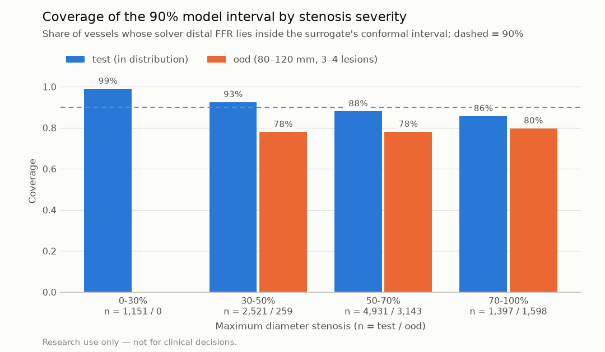
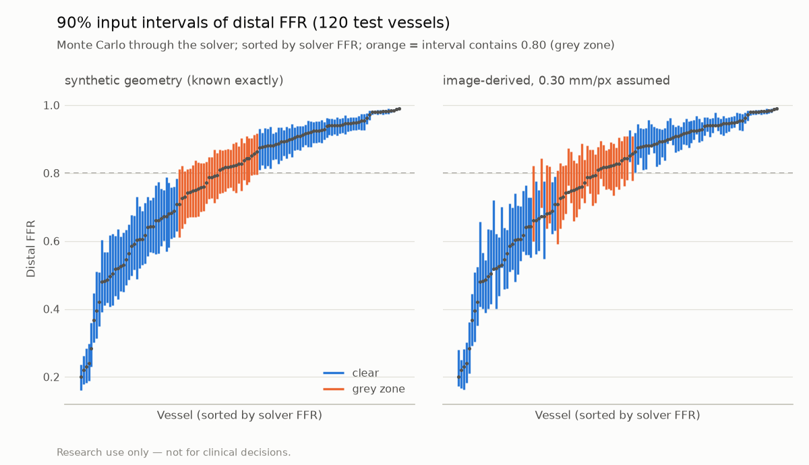

# Uncertainty and grey-zone flagging (P1)

> **Research use only — not for clinical decisions.**

Generated by `vstent uncertainty-report`. Do not edit by hand.

**What the intervals cover.** The *model interval* covers only the surrogate's error against the reduced-order solver (split-conformal, calibrated on synthetic vessels). The *input interval* covers only the listed input assumptions (Monte Carlo through the solver). Neither covers the error of the reduced-order model itself against real pressure-wire FFR, which is unknown until P4 / P6.

## Acceptance targets

| Metric | Value | Target | Pass |
|---|---|---|---|
| Conformal coverage on test (90% target) | 89.72% | 88%–92% | yes |
| Ensemble-mean distal MAE ≤ single model (test) | 0.00099 vs 0.00129 | ensemble ≤ single | yes |
| App stent-control update, worst server time | 159 ms | < 300 ms | yes |

OOD coverage (no target): 77.96%.

## Ensemble vs single model

Five members, the M3 configuration with seeds 0–4. The single model is the M3 model `runs/unet1d-20261028-125810`. Errors against the solver; distal FFR unless stated.

| Split | Model | n | Distal MAE | Max error | Curve MAE |
|---|---|---|---|---|---|
| test | ensemble mean | 10,000 | 0.00099 | 0.0804 | 0.00074 |
| test | single (M3) | 10,000 | 0.00129 | 0.0871 | 0.00092 |
| test | member s0 | 10,000 | 0.00129 | 0.0872 | 0.00092 |
| test | member s1 | 10,000 | 0.00126 | 0.0837 | 0.00094 |
| test | member s2 | 10,000 | 0.00139 | 0.0873 | 0.00101 |
| test | member s3 | 10,000 | 0.00134 | 0.0829 | 0.00100 |
| test | member s4 | 10,000 | 0.00124 | 0.0787 | 0.00091 |
| ood | ensemble mean | 5,000 | 0.00376 | 0.0737 | 0.00279 |
| ood | single (M3) | 5,000 | 0.00391 | 0.0701 | 0.00296 |
| ood | member s0 | 5,000 | 0.00391 | 0.0701 | 0.00296 |
| ood | member s1 | 5,000 | 0.00478 | 0.1022 | 0.00372 |
| ood | member s2 | 5,000 | 0.00476 | 0.0858 | 0.00345 |
| ood | member s3 | 5,000 | 0.00533 | 0.1027 | 0.00387 |
| ood | member s4 | 5,000 | 0.00492 | 0.0747 | 0.00359 |

Median ensemble SD of distal FFR: test 0.00073, ood 0.00311.

## Model interval: split-conformal 90%

Calibrated on all 10,000 `cal` vessels with the exported ONNX ensemble. Score |y − ŷ| / (σ + 0.0002), σ = ensemble SD of distal FFR; q̂ = 1.430. For comparison, an absolute score (one width for all vessels) gives q̂ = 0.00206. The `cal` split is used for calibration only: not for training, early stopping or choosing σ's floor, so the 90% guarantee holds for new vessels drawn like it. `val` chose each member's best epoch.

| Split | n | Coverage | Mean width | Median width | p95 width | Coverage (absolute) | Median width (absolute) |
|---|---|---|---|---|---|---|---|
| cal | 10,000 | 90.01% | 0.0037 | 0.0026 | 0.0093 | 90.01% | 0.0041 |
| val | 10,000 | 89.56% | 0.0037 | 0.0027 | 0.0096 | 90.05% | 0.0041 |
| test | 10,000 | 89.72% | 0.0037 | 0.0027 | 0.0097 | 89.63% | 0.0041 |
| ood | 5,000 | 77.96% | 0.0115 | 0.0095 | 0.0256 | 44.80% | 0.0041 |

Coverage by maximum diameter stenosis:

| Max DS | test n | test coverage | test median width | ood n | ood coverage | ood median width |
|---|---|---|---|---|---|---|
| 0-30% | 1,151 | 99.04% | 0.0010 | 0 | n/a | n/a |
| 30-50% | 2,521 | 92.26% | 0.0021 | 259 | 76.06% | 0.0072 |
| 50-70% | 4,931 | 87.57% | 0.0031 | 3,143 | 77.47% | 0.0091 |
| 70-100% | 1,397 | 85.04% | 0.0045 | 1,598 | 79.22% | 0.0106 |

**Grey zone at 0.80 (model interval only).** A vessel is flagged when its interval contains the threshold. *Disagreements* are vessels the surrogate and the solver put on different sides of the threshold.

| Split | Flagged | Disagreements | Disagreements flagged |
|---|---|---|---|
| cal | 0.77% | 24 | 22 (92%) |
| val | 0.65% | 17 | 16 (94%) |
| test | 0.65% | 16 | 14 (88%) |
| ood | 0.64% | 7 | 7 (100%) |

## Input interval: Monte Carlo through the solver (500 draws, seed 0)

Varied, each uniformly unless noted:

- pixel size ±10% (only when assumed; lengths and diameters scale together; a stent keeps its physical length);
- QCA diameter error: Gaussian, SD 0.107 px, correlation falling to 0.5 after 0.62 px, as measured on rendered tubes (`reports/qca_synthetic.md`); image cases only. Rendered tubes are idealised, so real QCA error is likely larger;
- hyperemic velocity ±0.1 m/s around the value used (half the synthetic sampling range), which recalibrates R_micro;
- Pa ±20 mmHg and Pv ±3 mmHg (half the synthetic sampling ranges).

Two settings: *synthetic geometry* (known exactly: velocity and pressures only) and *image-derived* with an assumed 0.30 mm/px (all four).

### Example vessels: 90% interval per assumption (Pa 90, Pv 5 mmHg, 0.35 m/s)

| Vessel | Setting | Solver FFR | Pixel size | QCA error | Velocity | Pa / Pv | All |
|---|---|---|---|---|---|---|---|
| Focal: 60 mm, 3.0 mm, one 12 mm lesion of 70% DS | synthetic geometry (known exactly) | 0.614 | n/a | n/a | 0.544–0.702 | 0.574–0.644 | 0.529–0.710 |
| Focal: 60 mm, 3.0 mm, one 12 mm lesion of 70% DS | image-derived, 0.30 mm/px assumed | 0.614 | 0.610–0.618 | 0.574–0.673 | 0.544–0.702 | 0.574–0.644 | 0.524–0.715 |
| Tandem: 70 mm, 3.0 mm, two 10 mm lesions of 60% DS | synthetic geometry (known exactly) | 0.705 | n/a | n/a | 0.638–0.784 | 0.666–0.734 | 0.622–0.792 |
| Tandem: 70 mm, 3.0 mm, two 10 mm lesions of 60% DS | image-derived, 0.30 mm/px assumed | 0.705 | 0.701–0.709 | 0.682–0.727 | 0.638–0.784 | 0.666–0.734 | 0.612–0.791 |

### 500 test vessels (each with its own Pa, Pv and velocity as the centre)

| Setting | Median width | p95 width | Flagged at 0.80 | Flagged, FFR 0.70–0.80 | Flagged, FFR 0.80–0.90 |
|---|---|---|---|---|---|
| synthetic geometry (known exactly) | 0.128 | 0.203 | 26.8% | 85% (n = 82) | 56% (n = 110) |
| image-derived, 0.30 mm/px assumed | 0.129 | 0.214 | 28.6% | 91% (n = 82) | 52% (n = 110) |

### Post-PCI: best plan for 45 test vessels with pre-PCI FFR < 0.80

Planned with the ensemble (screening by one member, final plans re-scored by the ensemble). Grey zone = interval contains the planner target 0.90. 96% of the best plans reach the target.

| Interval | Median width | Flagged |
|---|---|---|
| Model (90%, surrogate) | 0.0015 | 2% |
| Inputs, synthetic geometry (known exactly) | 0.030 | 18% |
| Inputs, image-derived, 0.30 mm/px assumed | 0.032 | 16% |

Post-PCI draws reuse the pre-PCI draws and their own R_micro, so the stent changes only the epicardial geometry.

## Limitations

- Both intervals are conditional on the reduced-order model being right; its own error against wire FFR or 3D CFD is not included (P4, P6).
- Conformal coverage holds on average over vessels like the calibration split (synthetic, unstented, pre-PCI). It is not guaranteed for OOD vessels (see the table), stented vessels or image-derived profiles.
- The input ranges are the synthetic sampling ranges, not measured patient-level uncertainties; the QCA error comes from idealised rendered tubes. Segmentation errors, overlap, foreshortening and side branches are not in the input interval.
- The two intervals are reported side by side, not combined.

## Provenance

- Ensemble `runs/unet1d_ens5-20261030-113237` (training commit `8b8e09c97a5141abb4e3f4ea39942448dc518cf9`, export commit `d2a9d123080793ff4c824332512a74d79e1ef3be`); single model `runs/unet1d-20261028-125810` (commit `deb7b35a42b322302b89ddfbc0e03a45bb21e4f1`).
- App latency from `reports/app_latency.json` (commit `d69b1543d73946b138a208e46bdedc451b28a2b3`, dirty: False, 2026-10-30T19:11:52+00:00).
- Report commit `03f19dcac2844b639e3df0bd87d40d575f1d56b2` (dirty: False), vstent 0.1.0, 2026-10-30T19:12:40+00:00.
