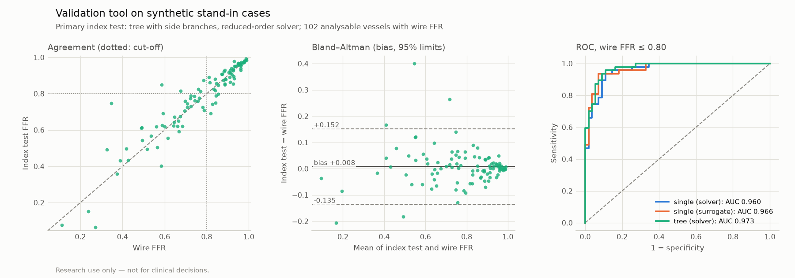

# Validation tool on synthetic stand-in cases

> Research use only — not for clinical decisions.

**Synthetic stand-in data, not a clinical validation.** This report shows that the validation tool (`vstent validate`, `docs/validation/`) runs end to end, from a case list to the statistics a study would report. Every number below comes from rendered synthetic cases (`vstent validate-synthetic`, `configs/validation_synthetic.yaml`) and says nothing about agreement with real wire FFR.

The study: 60 synthetic patients with 102 vessels (one to three each), rendered as 512 × 512 X-ray-like projections. Each vessel is a synthetic tree (P2 sampler; 0–3 side branches). The stand-in "wire FFR" is the tree solver's FFR at the end of the main vessel on the true geometry, with the patient's sampled Pa and Pv and the vessel's sampled hyperemic velocity. The case list gives the pipeline only what a study records: the image, the start point and the sensor position (each with a 1.5 px click error), the measured Pa, and for 88 of 102 vessels a calibrated pixel size (3% error); the others assume 0.30 mm/px. Pv and the velocity are the pipeline's fixed defaults. The main analysis uses the true lumen masks (standing in for analyst-corrected contours).

What it measures: the pipeline's image → geometry → FFR error under its own physics, plus the effect of its fixed assumptions (velocity, Pv, pixel size). The reference comes from the same tree physics as the tree index test, so tree vs reference agreement is optimistic by construction.

## Run

- Predictions locked 2026-10-30T23:04:42+00:00: `predictions_masks.csv`, SHA-256 `8befd8cd5c9db479…` (verified unchanged before scoring).
- Software: vstent 0.1.0, commit `fc64006c04461915f970233dc5af16648515d788` (dirty: False). Manifest SHA-256 `f60e58f85e6a9e15…`.
- Models: segmentation: `models/seg/seg_unet_r34-20261028-141743` (SHA-256 d4fe13dcb979…); surrogate: `models/surrogate/unet1d_ens5-20261030-113237` (SHA-256 780064ab4ece…). Vessel masks from the manifest used: True.

## Flow of vessels

- In the case list: 102
- Without a reference value: 0
- Excluded by the reference file (e.g. wire drift): 0
- Eligible: **102 vessels in 60 patients**

## Primary analysis: tree with side branches, reduced-order solver vs wire FFR

Pre-specified: index test FFR ≤ 0.80 vs wire FFR ≤ 0.80, per vessel; 95% intervals. 102 analysable vessels in 60 patients; 47 positive by wire (prevalence 46%). Patient bootstrap: 2000 resamples of whole patients (seed 0).

| Quantity | Estimate | Interval (vessels independent) | Interval (patient bootstrap) |
|---|---:|---:|---:|
| AUC (FFR ≤ cut-off) | 0.973 | 0.933–0.989 | 0.946–0.993 |
| Sensitivity | 0.894 | 0.774–0.954 | 0.800–0.976 |
| Specificity | 0.909 | 0.804–0.961 | 0.830–0.979 |
| Positive predictive value | 0.894 | 0.774–0.954 | – |
| Negative predictive value | 0.909 | 0.804–0.961 | – |
| Accuracy (analysable vessels) | 0.902 | 0.829–0.946 | 0.847–0.951 |
| Accuracy, intention to diagnose | 0.902 | 0.829–0.946 | – |
| Feasibility (analysable / eligible) | 1.000 | 0.964–1.000 | – |
| Bias (index − wire) | 0.008 | -0.006–0.023 | -0.005–0.025 |
| SD of differences | 0.073 | – | – |
| Lower limit of agreement | -0.135 | -0.160–-0.110 | – |
| Upper limit of agreement | 0.152 | 0.127–0.177 | – |
| Mean absolute difference | 0.045 | – | 0.034–0.058 |
| Pearson r | 0.930 | 0.899–0.953 | – |
| Proportional bias (slope of differences on means) | 0.003 | -0.073–0.078 | – |

2 × 2 table: TP 42, FP 5, FN 5, TN 50. Intention to diagnose counts the 0 eligible vessel(s) the index test could not analyse as misclassified.

## All index tests vs wire FFR

| Index test | Analysable | AUC (interval) | Sensitivity | Specificity | Accuracy | Accuracy, ITD | Bias | Limits of agreement | MAE |
|---|---:|---:|---:|---:|---:|---:|---:|---:|---:|
| single path, reduced-order solver | 102 / 102 | 0.960 (0.912–0.983) | 0.936 | 0.873 | 0.902 | 0.902 | -0.022 | -0.185 to 0.141 | 0.056 |
| single path, surrogate (ensemble mean) | 102 / 102 | 0.966 (0.919–0.986) | 0.936 | 0.855 | 0.892 | 0.892 | -0.023 | -0.183 to 0.138 | 0.054 |
| tree with side branches, reduced-order solver | 102 / 102 | 0.973 (0.933–0.989) | 0.894 | 0.909 | 0.902 | 0.902 | 0.008 | -0.135 to 0.152 | 0.045 |

## Grey zone (P1 intervals, single path)

A vessel is flagged when its model or input interval contains 0.80. Classification by the solver's FFR.

| | Vessels | Accuracy (interval) |
|---|---:|---:|
| Not flagged | 70 | 0.957 (0.881–0.985) |
| Flagged | 32 (31%) | 0.781 (0.612–0.890) |
| All | 102 | 0.902 |
| Hybrid: wire only when flagged | 102 | 0.971 (0.917–0.990) |

The hybrid strategy would need the wire in 31% of vessels.

## Per vessel territory (tree (solver))

| Vessel | Analysable / eligible | Prevalence | AUC | Sensitivity | Specificity | Bias | MAE |
|---|---:|---:|---:|---:|---:|---:|---:|
| LAD | 38 / 38 | 47% | 0.978 | 0.889 | 0.900 | 0.002 | 0.039 |
| LCX | 32 / 32 | 47% | 0.980 | 0.867 | 0.941 | 0.016 | 0.043 |
| RCA | 32 / 32 | 44% | 0.976 | 0.929 | 0.889 | 0.008 | 0.056 |

## Against the known truth (synthetic only)

Masks run, single-path QCA of the main vessel, median (interquartile range):

- Path length, measured − true: -5.0 (-6.7 to -3.5) mm (102 vessels). QCA trims one vessel diameter at each end of the path (M5), and pixel sizes are given with a 3% error or assumed (0.30 mm/px).
- Minimum lumen diameter, measured − true: +0.01 (-0.02 to +0.06) mm.
- Side branches found by the tree QCA: exactly the true number in 99% of 102 vessels; found − true +0 (+0 to +0). Branches shorter than 5 mm or thinner than 0.3 × their parent are not modelled by design (D35).

Inside the reference itself (true geometry, the reference's own pressures and velocity): the main vessel alone as a single path vs the tree with its side branches:

- Mean FFR difference, main alone − tree: -0.040 (SD 0.047); the classification at 0.80 differs in 7 of 102 vessels.

So a single-path index test is biased low against this reference by construction: the comparison of single-path and tree index tests above shows the effect of side branches *under this model*, not which is closer to real wire FFR.

Primary index test by pixel-size calibration (tree (solver)):

| Pixel size | Vessels | Mean difference | Mean absolute difference |
|---|---:|---:|---:|
| assumed (0.30 mm/px) | 14 | +0.008 | 0.039 |
| given | 88 | +0.009 | 0.046 |

### Error budget of the tree index test

The same vessels (masks run), each error against the stand-in reference:

| Inputs to the tree solver | Bias | SD | MAE | Misclassified at 0.80 |
|---|---:|---:|---:|---:|
| Full pipeline (measured geometry; fixed Pv and velocity; pixel size as given or assumed) | +0.008 | 0.073 | 0.045 | 10 of 102 |
| Measured geometry, true pixel size, Pv and velocity (measurement error only) | +0.010 | 0.063 | 0.034 | 6 of 102 |
| True geometry, the pipeline's fixed Pv and velocity (assumption error only) | -0.002 | 0.035 | 0.027 | 7 of 102 |

The fixed hyperemic velocity (0.35 m/s; the stand-in samples 0.25–0.45 m/s) and Pv are the error P7 targets with a patient-specific flow estimate.

Measurement error only: the inlet reference diameter sets the flow (Q = v_hyp · π r_ref(0)², M1). Its relative error (measured / true − 1) is -0.7 (-5.3 to +1.5) %, and its Spearman correlation with the FFR error is -0.66. Side branches missed: 1 of 102 vessels (a missed branch's flow goes down the main vessel and lowers its FFR). Largest errors:

| Vessel | Reference FFR | Error | Inlet reference, true → measured (mm) | MLD, true → measured (mm) | Side branches, true → found |
|---|---:|---:|---:|---:|---:|
| SYN-029-LCX | 0.347 | +0.362 | 2.90 → 1.62 | 0.69 → 0.68 | 0 → 0 |
| SYN-012-RCA | 0.586 | +0.247 | 2.60 → 1.38 | 0.95 → 0.95 | 2 → 2 |
| SYN-036-RCA | 0.271 | -0.233 | 3.27 → 3.26 | 0.50 → 0.14 | 1 → 1 |
| SYN-035-LCX | 0.677 | +0.127 | 3.76 → 2.95 | 1.14 → 1.11 | 3 → 3 |
| SYN-010-RCA | 0.584 | -0.124 | 3.84 → 3.94 | 0.82 → 0.81 | 3 → 1 |
| SYN-019-RCA | 0.237 | -0.121 | 3.63 → 3.40 | 0.61 → 0.33 | 1 → 1 |

## With the automatic segmenter

The same cases, with the vessel segmented by the ARCADE-trained model instead of taken from the true mask. The rendered images match ARCADE's vessel contrast and noise (D39), but not its anatomy: one vessel tree on a smooth background, without the catheter, the other coronary vessels, ribs or the diaphragm. The segmenter misses many of these vessels, so the numbers below show a domain gap between rendered and clinical images (to be closed by P8's rendered angiograms), not the segmenter's accuracy on clinical angiograms (`reports/seg_eval.md`).

| Index test | Analysable / eligible | AUC | Accuracy | Accuracy, ITD | MAE |
|---|---:|---:|---:|---:|---:|
| single path, reduced-order solver | 39 / 102 (38%) | 0.908 (0.768–0.967) | 0.718 | 0.275 | 0.111 |
| single path, surrogate (ensemble mean) | 39 / 102 (38%) | 0.904 (0.756–0.966) | 0.744 | 0.284 | 0.110 |
| tree with side branches, reduced-order solver | 39 / 102 (38%) | 0.913 (0.775–0.970) | 0.718 | 0.275 | 0.111 |

Why single-path analysis failed:

- 44 × ValueError: point off the segmented vessel
- 11 × ValueError: no vessel found
- 8 × ValueError: no path between the points

